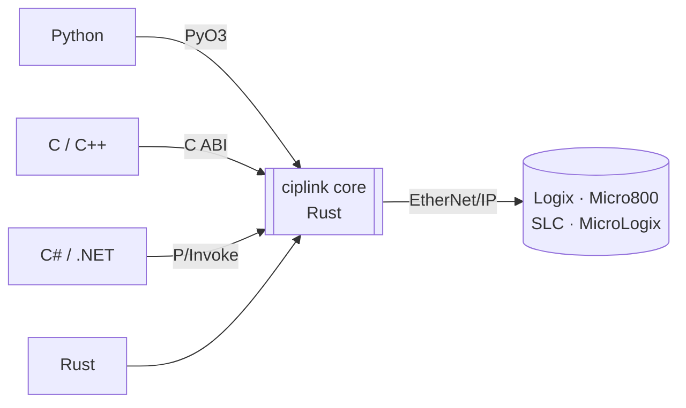

<div align="center">

# ciplink

**Read and write Allen-Bradley PLC tags over EtherNet/IP from Python, C, C++, C# or Rust.**

[](https://github.com/RowanRama/ciplink/actions/workflows/ci.yml)
[](https://pypi.org/project/ciplink/)
[](https://crates.io/crates/ciplink)
[](https://www.nuget.org/packages/Ciplink)
[](https://pypi.org/project/ciplink/)
[](LICENSE)

[Install](#install) · [Quick start](#quick-start) · [Simulator](#test-without-a-plc) · [Build from source](#build-from-source)

</div>

---

ciplink is a fork of [pycomm3](https://github.com/ottowayi/pycomm3) rebuilt on a **shared Rust core**. Every
language calls the same driver, so tag reads, packet packing and error handling behave the same everywhere.
In Python it keeps the familiar pycomm3-style API and uses several times less CPU per call.



## Features

| | |
|---|---|
| **Controllers** | ControlLogix, CompactLogix, GuardLogix and Micro800 with `LogixDriver`; SLC 500 and MicroLogix with `SLCDriver`; generic CIP messaging to any EtherNet/IP device with `CIPDriver` |
| **Tag types** | atomic types, arrays, strings, UDTs (whole or by member), AOIs, bits of integers and BOOL arrays |
| **Throughput** | many tags packed into each packet, with large values fragmented and chunked automatically |
| **Tag discovery** | the tag list and UDT definitions are uploaded on connect, or loaded on first use with `lazy_tags`; a binary tag cache makes restarts near-instant |
| **Online-edit safe** | tags are addressed by instance ID and checked against the controller's tag-table version on every read and write, so an online edit never silently returns the wrong tag |
| **Extras** | tag descriptions, PLC clock, device discovery, RSWho-style device browsing, module identity, and a simulated controller for testing |
| **Trends** | the controller samples tags at a fixed period (down to 1 ms) and the driver uploads them in batches, like a Studio 5000 trend |

## Install

| Language | Command |
|---|---|
| 🐍 **Python 3.9+** | `pip install ciplink` |
| 🦀 **Rust** | `cargo add ciplink` |
| 🟣 **C# / .NET 8+** | `dotnet add package Ciplink` |
| ⚙️ **C / C++** | `ciplink.h`, `ciplink.hpp` and prebuilt libraries on the [releases page](https://github.com/RowanRama/ciplink/releases) |

The Python wheels and the NuGet package already contain the compiled core, so you don't need a Rust toolchain.

## Quick start

The path is the controller's IP address, `IP/slot` for a ControlLogix outside slot 0, or a full route such as
`192.0.2.10/bp/2/enet/192.0.2.20/bp/0`. Every read and write returns one result per tag. A failure is reported on
that result, with a message and an error kind (not found, bad value, access denied and so on), rather than raised
as an exception.

<details open>
<summary><b>Python</b></summary>

```python
from ciplink import LogixDriver

with LogixDriver("192.0.2.10") as plc:
    print(plc.read("Counter"))           # Tag(tag='Counter', value=42, type='DINT', error=None)
    level, recipe = plc.read("Tank.Level", "Recipe{10}")
    plc.write(("Counter", 0), ("Tank.Setpoint", 75.5))
```
</details>

<details>
<summary><b>Rust</b></summary>

```rust
use ciplink::Value;
use ciplink::logix::driver::{LogixDriver, LogixOptions};

let plc = LogixDriver::new("192.0.2.10", LogixOptions::default())?;
plc.open()?;
for tag in plc.read(&["Counter", "Tank.Level"]) {
    println!("{} = {:?} {:?}", tag.tag, tag.value, tag.error);
}
plc.write(&[("Counter", Value::DInt(0))]);
```
</details>

<details>
<summary><b>C#</b></summary>

```csharp
using Ciplink;

using var plc = new LogixDriver("192.0.2.10");
plc.Open();
Tag counter = plc.Read("Counter");
Console.WriteLine(counter.IsOk ? $"{counter.Name} = {counter.Value}" : counter.Error);
plc.Write("Counter", 0);
```
</details>

<details>
<summary><b>C++</b></summary>

```cpp
#include "ciplink.hpp"

ciplink::Logix plc("192.0.2.10");
plc.open();
for (const ciplink::Tag& t : plc.read({"Counter", "Tank.Level"}))
    std::cout << t.tag << " = " << ciplink::to_json(t.value) << "\n";
plc.write_tag("Counter", 0);
```
</details>

## Trends

For data faster than polling gives, a trend has the controller sample tags every `period_ms` into its own trend
buffer (the trend object Studio 5000 uses), on a connection of its own. Each sample carries the controller's
timestamp. A pen can be any atomic tag, member or array element of up to 32 bits (BOOL, SINT, INT, DINT, USINT,
UINT, UDINT, REAL) or a bit (`Tag.3`). 64-bit types (LINT, LREAL) can't be trended. The controller deletes the trend
when it's closed or when its connection drops. Every binding has trends: `plc.trend(...)` in Python, Rust and C++,
`plc.Trend(...)` in C#, `ciplink_trend_start` in C.

```python
import time
from ciplink import LogixDriver

with LogixDriver("192.0.2.10") as plc:
    with plc.trend("Motor.Speed", "Tank.Level", "Valve.Open", period_ms=1) as trend:
        while trend.running:
            time.sleep(0.1)
            for sample in trend.read():          # TrendSample(timestamp_us, elapsed_us, values)
                print(sample.timestamp, sample.values)
```

`capacity` (default 4096) bounds the samples waiting for `read()`; the oldest are dropped when it is full and
counted in `dropped_samples`. `duration` (seconds) stops the trend by itself.

## Browse devices

Like RSWho in FactoryTalk Linx: `get_ports()` lists a device's ports, `browse_port()` finds the module in each slot,
the node at each address or, on an EtherNet/IP port, every device on the port's subnet. Every node found has a
`route` to browse further (`""` is the device at the IP, `"bp/3"` the module in slot 3, `"bp/2/enet/192.168.1.10"` a
device behind the module in slot 2). `python -m examples.device_browser` is a small tree browser built on them. Every binding has browsing:
`get_ports`/`browse_port`/`scan_port` in Rust, C++ and Python (`iter_port` streams), `GetPorts`/`BrowsePort`/
`ScanPort` in C#, `ciplink_get_ports`/`ciplink_browse_port`/`ciplink_scan_port` in C.

```python
from ciplink import CIPDriver

with CIPDriver("192.0.2.10") as drv:
    for port in drv.get_ports():                      # e.g. Backplane, EtherNet/IP
        for node in drv.browse_port("", port):        # every slot, or every address of the subnet
            print(node["route"], node["identity"] and node["identity"]["product_name"])
```

## Test without a PLC

`ciplink-sim` is a simulated Logix or SLC controller that speaks real EtherNet/IP. Load it with tags and UDTs from
a JSON file or an L5X export, then point any driver at `127.0.0.1`.

```sh
cargo run -p ciplink-sim -- --config tools/sim/example_controller.json --port 44818
```

## Build from source

You need Rust (stable). The Python package also needs Python 3.9+ with [uv](https://docs.astral.sh/uv/), and the
C# binding needs the .NET 8+ SDK.

```sh
cargo test --workspace                # core, simulator, C ABI and the Python ↔ Rust parity harness
uvx maturin build --release           # Python wheel, written to target/wheels/
bash bindings/cpp/build_and_test.sh   # C++ binding
dotnet test bindings/dotnet           # C# binding
```

See [CONTRIBUTING.md](CONTRIBUTING.md) for how the parity fixtures are generated and how releases are published.

<details>
<summary><b>Project layout</b></summary>

| Path | Contents |
|---|---|
| `crates/ciplink` | the Rust driver core |
| `crates/ciplink-py`, `ciplink/` | the Python extension module and package |
| `crates/ciplink-ffi` | the C ABI and `ciplink.h` |
| `bindings/cpp`, `bindings/dotnet` | the C++ and C# bindings |
| `crates/ciplink-sim` | the simulated controller |
</details>

## License

MIT. Built on [pycomm3](https://github.com/ottowayi/pycomm3) by Ian Ottoway and pycomm by Agostino Ruscito.
