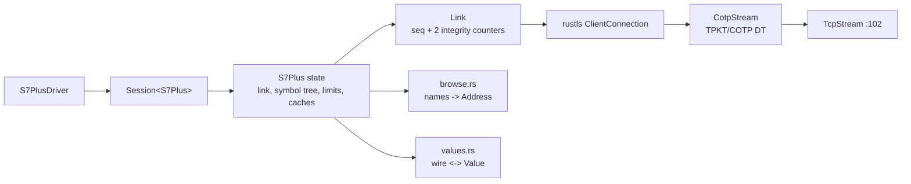

# S7comm-plus driver: design

Status: phase 2 of adding Siemens, Modbus and OPC UA to ciplink. Branch `feature/s7commplus`, on top of
`feature/session-core`. Design only; the [checklist](#implementation-checklist) is the order of work.

This page is for the engineers who build it. It is not part of the published wiki (`mkdocs.yml` excludes
`docs/dev/`). The wire format is in [S7comm-plus protocol notes](s7commplus-protocol.md) ("the spec" below, section
numbers refer to it); the queue, handles, reconnect and subscriptions are in [Session core](session-core.md).

Clean room: this design and the code that follows it are written from the spec, the private captures (facts: PDU
hex) and the private clean-room checker only. Nothing from any other S7comm-plus implementation is read or used.
Nothing private (real tag, block or project names, serial numbers, certificates, fingerprints, captures) is
committed; every example on this page is invented.

## Decisions at a glance

| Topic | Decision |
|---|---|
| Scope | S7-1500 / S7-1200 with secure PG/HMI communication (InitSsl + TLS 1.3). No legacy non-TLS login, no password login (legitimation), no comments (descriptions are always None), no Siemens hardware trends, no alarms, no CPU start/stop, no PLC-side subscriptions. |
| Where | `crates/ciplink/src/s7plus/`, all new files. The only shared-file edits are one `pub mod s7plus;` line, two dependencies, and the binding/server registration points listed in [Merge points](#merge-points). |
| Session | `S7Plus` (the protocol state) implements the crate-private `Protocol` trait; `S7PlusDriver` wraps `Session<S7Plus>` exactly as `LogixDriver` wraps `Session<Logix>`. Queue, merged reads, handles, subscriptions, reconnect and callbacks are the session core's, unchanged. |
| Requests in flight | One at a time (spec 6.8 default). The session thread is already strictly sequential. |
| Names | TIA style: `Line1.Conveyor.Speed`, `Line1.Items[3].Weight`, `Line1.Grid` (n-dim arrays whole only), PLC tags (I/Q/M) by their bare name (`StartButton`). Double quotes around a segment are accepted and stripped (`"Line1".Speed`). Exact match first, then case-insensitive. |
| Address | Resolved from the browsed symbol tree: access area + LIDs + symbol CRC (from the vartype member CRCs, spec 11.7). CRC 0 for any path with an array index (spec 11.7 defines no CRC for index LIDs). |
| Batching | At most `max_read` items per GetMultiVariables and `max_write` per SetMultiVariables, both read from system limits LIDs 1000 / 1001 at connect (100 on the bench CPU; 100 if the limits read fails). Writes are also capped at 60,000 encoded bytes per request (one frame, spec 5). |
| Reads merge | `merges_reads()` is true: item failures are per item, so one caller's bad tag never fails another's. |
| Values | Onto the existing `Value` enum; no new variant. BYTE/WORD/DWORD/LWORD as `USInt`/`UInt`/`UDInt`/`ULInt`, TIME and S5TIME as `DInt` ms, LTIME as `LInt` ns, every date/time-of-day type as an ISO 8601 `String`, STRING/WSTRING/CHAR/WCHAR as `String`, whole structs as `Struct`, arrays as `Array`. `data_type` carries the S7 type name (`"WORD"`, `"DTL"`, `"REAL[50]"`). |
| Writes | Scalars, strings, date/time types, DTL, array elements and whole elementary arrays (not BOOL arrays). Whole structs and whole BOOL arrays are refused locally (`BadRequest`, "write the members / elements"): both are untested on a CPU (spec 17.3). |
| TLS | rustls 0.23, `ring` provider, TLS 1.3 only, AES-256-GCM and AES-128-GCM, no SNI (IP server name), no ALPN, no resumption. Chain and name checks off; the TLS 1.3 CertificateVerify signature is still checked. The certificate's SHA-256 fingerprint is exposed; option `tls_fingerprint` pins it (mismatch fails `open`). |
| Browse | On `open` by default (`init_tags`, as Logix): DB list (filtered Explore), DB type RIDs (LID 1 reads), all type info (Explore RID 537), the three captured requests byte for byte. With `init_tags = false`, the first request that needs a name browses. |
| Reconnect | Full new link (COTP, InitSsl, TLS, session). The symbol table is kept unless the session's ServerSessionVersion changed. Item errors that mean "program changed" (CRC mismatch -17, LID missing -255) re-browse once and retry the read's failed items once; writes are never retried. |
| Keep-alive | Default 15 s idle (spec 10.7: 10 to 20 s; Logix keeps 30 s). The request is the captured protection-level read (GetVarSubStreamed, attribute 1842 of the session object). TCP keep-alive as in `TcpTransport`. |
| Errors | Item errors by their low 16 bits: -255 and -61 `NotFound`, -17 `TableChanged`, others `Device` with the full 64-bit value in the message. Anything the spec calls fatal (Error PDU, negative return value, sequence or integrity mismatch, parse failure, TLS or socket error) is `Error::Comm` and drops the link, so the session reconnects. |
| Simulator | `ciplink-sim` gains an S7comm-plus device (TCP only, `127.0.0.1`), with a TLS server certificate generated at start (rcgen, `ring`), invented DBs and types from JSON, and faults. |
| Bindings | Python `ciplink.S7PlusDriver`, C ABI `ciplink_s7plus_new` (+ two `ciplink_s7plus_*` extras; the generic calls work on the new handle), C++ `ciplink::S7Plus`, .NET `S7PlusDriver`, ciplink-server `protocol = "s7plus"`. |
| Bench | a real S7-1500 (`S7PLUS_BENCH=<ip>`), read only apart from one agreed test tag. |

## Module layout

```text
crates/ciplink/src/s7plus/
  mod.rs      pub use of the public types; module docs (scope, names, values)
  codec.rs    Cursor (bounds-checked), VLQ32/SVLQ32/VLQ64/SVLQ64, symbol CRC, wire values (flags, datatype, payload):
              WireValue enum, encode/decode; pure, no I/O
  pdu.rs      72-frames: split / reassemble, system-event (fe) frames; request and response headers; one builder and
              one parser per function: InitSsl, CreateObject, SetMultiVariables (session setup and tag write),
              GetMultiVariables, Explore, GetVarSubStreamed, DeleteObject; object tree (A1/A2/A3/AB/AC) parser;
              return value / item error type; pure, no I/O
  cotp.rs     TPKT + COTP CR/CC/DT; CotpStream: Read + Write over a byte stream, DT payloads as one continuous stream
  tls.rs      rustls client config, the pinning verifier, fingerprint formatting and parsing
  link.rs     Link: TCP connect, COTP, InitSsl, TLS, sequence and integrity counters, send/receive one PDU, close
  browse.rs   type-info objects to S7Type, the DB list and areas to the symbol tree, name resolution to an Address
  values.rs   S7 type <-> ciplink Value (dates, strings, packed structs, BOOL arrays), write coercion
  types.rs    public data: S7Tag, S7Type, S7Member, S7Symbol, CpuInfo, Softdatatype names
  driver.rs   S7Plus (state, impl Protocol), S7PlusDriver, S7PlusOptions
crates/ciplink/tests/
  s7plus_spec.rs      every hex example of the public spec, byte for byte (built and parsed)
  s7plus_private.rs   the private captures; every test returns early when S7PLUS_PRIVATE is unset
crates/ciplink/examples/
  s7plus_bench.rs     read-only bench check, address from S7PLUS_BENCH (never a default address)
```

Everything is `pub(crate)` except what `types.rs` and `driver.rs` export through `ciplink::s7plus`. The S7 TCP
connect duplicates the ~15 lines of `TcpTransport::connect` (nodelay, keep-alive) instead of editing
`transport.rs`, which the Modbus branch is likely to touch; fold the two into one helper after both have landed.



### Dependencies

`crates/ciplink/Cargo.toml`:

```toml
rustls = { version = "0.23", default-features = false, features = ["ring", "std", "logging"] }
ring = "0.17"   # SHA-256 of the certificate; already in the tree through rustls
```

`ring` builds with the MinGW gcc on `x86_64-pc-windows-gnu` (no MSVC, no cmake, unlike aws-lc-rs) and on every CI
target. No zlib (comments are out of scope). `crates/ciplink-sim/Cargo.toml` adds
`rcgen = { version = "0.13", default-features = false, features = ["ring"] }` and the same `rustls`.

## The link

### Connect (spec 2, 3, 4, 10.1)

1. TCP connect to `host:port` (default port 102) within `socket_timeout`; nodelay; TCP keep-alive 10 s / 5 s.
2. COTP CR with TPDU size `0a`, calling TSAP `06 00`, called TSAP `SIMATIC-ROOT-HMI`; expect CC (`d0`), take
   neither its source reference nor anything else as fixed. A DR (`80`) is `Ok(false)` from `open` ("the target
   refused the session"), anything else `Err(Comm)`.
3. InitSsl (cleartext, version 1, sequence 1, session 0x120). Its response must have return value 0.
4. TLS handshake over `CotpStream`.
5. CreateObject (version 1, sequence 2), exactly the captured bytes of spec 10.2 apart from the sequence. Keep the
   first object ID as the session ID and the attribute-306 struct value bytes as received.
6. SetMultiVariables writing struct 306 back (spec 10.4), byte for byte.
7. System limits read (spec 10.5): `max_read` = LID 1000, `max_write` = LID 1001; on an item error or a value of 0
   keep 100.
8. CPU name and identification (spec 13.7: RID 50 attribute 233, RID 49 attribute 3753); cached for `name()` and
   `get_plc_info()`. Failure here is logged and leaves them None; it does not fail `open`.
9. Browse, if `init_tags` (below).

### CotpStream

`CotpStream<S: Read + Write>` makes the DT payloads one byte stream for rustls:

- `read`: when its buffer is empty, read one TPKT frame (4-byte header, length checked: 7 to 1024 + slack, never
  trusted beyond 65535), skip a zero-payload DT, append the payload. **EOT is ignored** (spec 2.3: the PLC sets it
  on frames whose TLS record continues).
- `write`: split the bytes of each call into DT frames of at most 1017 payload bytes, EOT 0 on all but the last
  (spec 2.3, accepted by the PLC).
- Any non-DT TPDU after CC (DR, ER) is an `io::Error` that becomes `Error::Comm` and drops the link.

`StreamOwned<ClientConnection, CotpStream<TcpStream>>` is the TLS stream; it is `Send`, and the session thread is
its only user.

### Frames and PDUs (spec 5, 6)

- Send: one PDU = `72 02 LL LL <data> 72 02 00 00` in one `write_all` (one frame, as captured). A request whose
  data part would exceed 65,535 bytes is never built (the write batcher caps at 60,000).
- Receive: read 4-byte frame headers; a frame with length 0 is the trailer that ends the PDU; data parts are
  appended up to a cap of 16 MiB per PDU (the largest seen is 466 KB). The version byte must be the one of the
  request (`01` during connect, `02` after). A version `fe` frame (system event, no trailer, fixed-width integers)
  is read and ignored, unless its return value is negative, which is fatal.
- The response's opcode must be `32`, its function and sequence those of the request. Anything else, or function
  `04 B1` / `05 A9` (Error PDUs), is fatal.
- Sequence: per link, 1 for InitSsl, +1 per request, `0xFFFF` wraps to 1.
- Integrity: two `u32` counters per link (spec 6.6): `set` for SetMultiVariables, SetVariable, CreateObject and
  DeleteObject after session setup, `get` for everything else; each starts so the first value sent is 1 and wraps.
  For the responses that carry one (GetMultiVariables, GetVarSubStreamed, Explore, tag-write SetMultiVariables),
  `response == sequence.wrapping_add(request)` or the link is dropped. The session-setup response's field is read
  and ignored (it is 0).

### Close (spec 10.8, 4.4)

`close()`: DeleteObject of the session ID (integrity from `set`), read its response (no integrity ID; return value
non-negative), send `close_notify`, shut the TCP socket. Do not wait for the PLC's `close_notify`: it never sends
one. Errors during close are returned but the link is dropped either way. `drop_link()` drops the stream without
sending anything.

## TLS

```rust
/// Client config for one connect: TLS 1.3 only, AES-GCM only, no resumption, our verifier.
fn client_config(pin: Option<[u8; 32]>, seen: Arc<Mutex<Option<[u8; 32]>>>) -> Arc<rustls::ClientConfig>;

/// Accepts any chain and name (the PLC certificate is self-signed and names the project IP, which differs
/// behind NAT), records the end-entity certificate's SHA-256, and refuses it if a pin is set and differs.
/// The handshake signature is verified with the presented key, so a pin proves possession of the pinned key.
#[derive(Debug)]
struct PinVerifier { pin: Option<[u8; 32]>, seen: Arc<Mutex<Option<[u8; 32]>>>, algorithms: WebPkiSupportedAlgorithms }
impl rustls::client::danger::ServerCertVerifier for PinVerifier {
    fn verify_server_cert(..) -> Result<ServerCertVerified, rustls::Error>; // record, compare with the pin
    fn verify_tls12_signature(..) -> ..;  // not reachable with TLS 1.3 only: return an error
    fn verify_tls13_signature(..) -> ..;  // rustls::crypto::verify_tls13_signature(.., &self.algorithms)
    fn supported_verify_schemes(&self) -> Vec<SignatureScheme>; // the ring provider's (includes ECDSA P-256 SHA-256)
}
```

- Provider: `rustls::crypto::ring::default_provider()` with `cipher_suites` kept to `TLS13_AES_256_GCM_SHA384` and
  `TLS13_AES_128_GCM_SHA256` (what the CPU was seen to accept); key exchange groups as the provider has them
  (X25519 first). Built with `ClientConfig::builder_with_provider(..).with_protocol_versions(&[&TLS13])`.
- `resumption = Resumption::disabled()`: a full handshake on every connect (spec 4.2). The PLC's post-handshake
  NewSessionTicket records are consumed by rustls.
- Server name: `ServerName::IpAddress` of the address connected to. rustls sends no SNI for an IP address; no ALPN
  is configured.
- Fingerprint: SHA-256 of the DER end-entity certificate (not of the public key: it is what operators see in a
  browser or `openssl x509 -fingerprint -sha256`). Formatted as 32 upper-case hex pairs joined by `:`; the option
  accepts upper or lower case, with or without `:` or spaces, and a malformed pin is `Error::Request` from `new`.
- A pin mismatch fails the handshake; `open` returns `Error::Comm("TLS certificate fingerprint AB:.. does not match
  the pinned CD:..")`. During a reconnect the attempt fails the same way and the session keeps retrying (a new
  hardware configuration download changes the certificate; the operator must re-pin).
- The fingerprint of the latest handshake (successful or refused by the pin) stays readable through
  `certificate_fingerprint()`, so a UI can show it for trust-on-first-use. The driver itself does not prompt.

## The protocol state and the trait

```rust
/// The S7comm-plus driver's state: the link, the symbol tree and what open read.
pub(crate) struct S7Plus {
    host: String,
    port: u16,
    options: S7PlusOptions,
    link: Option<Link>,                         // None while not connected
    session_version: Option<Vec<u8>>,           // struct 306 bytes of the current session
    browsed_version: Option<Vec<u8>>,           // ... of the session the tree was browsed in
    tree: Option<Arc<SymbolTree>>,              // None until browsed
    tree_generation: u64,                       // +1 each browse whose result differs (server `version()`)
    stale: bool,                                // a write saw a CRC / LID error: browse before the next request
    last_error_browse: Option<Instant>,         // at most one error-driven browse per minute
    resolved: HashMap<String, Result<Address, TagError>>, // name cache, cleared on browse
    max_read: usize,
    max_write: usize,
    info: Option<CpuInfo>,
    fingerprint: Arc<Mutex<Option<[u8; 32]>>>, // written by the verifier
}

impl Protocol for S7Plus {
    fn open(&mut self) -> Result<bool>;   // connect steps 1-9; a failure after TCP connect drops the link
    fn reopen(&mut self) -> Result<bool>; // steps 1-8; browse only if the tree is None, `stale`, or
                                          // session_version != browsed_version
    fn close(&mut self) -> Result<()>;    // DeleteObject, close_notify, TCP close
    fn drop_link(&mut self);              // link = None
    fn connected(&self) -> bool;          // link.is_some()
    fn read(&mut self, tags: &[&str]) -> Result<Vec<TagResult>>;
    fn write(&mut self, items: &[(&str, Value)]) -> Result<Vec<TagResult>>;
    fn keep_alive(&mut self) -> Result<()>; // GetVarSubStreamed (session ID, attribute 1842); value ignored
    // merges_reads: default true
}
```

Every request method that fails with a fatal error sets `link = None` before returning the `Err`, which is how
the session sees a lost link. `connected()` therefore needs no I/O.

The ServerSessionVersion comparison on reconnect is a cheap guess that a download happened (its project fields
are expected to change with the project); it is unverified (the bench may not be changed). The CRC check on every
scalar read is the real protection: a renamed or retyped member gives item error -17, never another variable's
value.

## Public Rust API

All in `ciplink::s7plus`. Names and behaviour follow `LogixDriver` wherever S7 has the same thing.

```rust
/// Options of an [`S7PlusDriver`].
#[derive(Clone, Debug, PartialEq, Eq)]
pub struct S7PlusOptions {
    /// Timeout of the TCP connect and of each socket read and write; None blocks forever. Default 10 s (a 466 KB
    /// browse reply arrives over several seconds, but never 10 s without a byte).
    pub socket_timeout: Option<Duration>,
    /// Browse the symbol table on `open` (and on a reconnect that needs it). With false, the first request that
    /// needs a tag name browses. Default true.
    pub init_tags: bool,
    /// SHA-256 fingerprint of the PLC certificate to require, hex with or without `:`. None accepts any
    /// certificate (the default; see `certificate_fingerprint`).
    pub tls_fingerprint: Option<String>,
}

impl S7PlusOptions {
    /// The session options an S7 driver uses by default: `SessionOptions::default()` with keep_alive 15 s.
    pub fn default_session() -> SessionOptions;
}

pub struct S7PlusDriver { session: Session<S7Plus>, link: Arc<AtomicBool> /* for connected() without waiting */ }

impl S7PlusDriver {
    /// A driver for `path` (`host` or `host:port`, default port 102); not connected until `open`.
    /// Reconnects and keeps alive (`S7PlusOptions::default_session()`). A malformed pin is Err(Request).
    pub fn new(path: &str, options: S7PlusOptions) -> Result<Self>;
    /// A driver with explicit session options.
    pub fn with_session(path: &str, options: S7PlusOptions, session: SessionOptions) -> Result<Self>;

    pub fn open(&self) -> Result<bool>;                 // Ok(false): COTP refused
    pub fn close(&self) -> Result<()>;
    pub fn stop(&self);
    pub fn connected(&self) -> bool;                    // never waits
    pub fn connection_state(&self) -> ConnectionState;  // never waits
    pub fn set_connection_callback(&self, callback: Option<ConnectionCallback>);

    pub fn read(&self, tags: &[&str]) -> Result<Vec<TagResult>>;
    pub fn write(&self, items: &[(&str, Value)]) -> Result<Vec<TagResult>>;
    pub fn read_async(&self, tags: &[&str]) -> Handle<Vec<TagResult>>;
    pub fn write_async(&self, items: &[(&str, Value)]) -> Handle<Vec<TagResult>>;
    pub fn subscribe(&self, tags: &[&str], options: SubscribeOptions) -> Result<Subscription>;

    /// Top-level tags: every data block (a structure tag of its DB type) and every PLC tag of the I, Q and M
    /// areas, in browse order. Empty before the first browse. Waits for the request in flight; no I/O.
    pub fn tags(&self) -> IndexMap<String, S7Tag>;
    /// The structure types the tags use (UDTs, STRUCT members, FB interfaces, system types), by type name.
    pub fn data_types(&self) -> IndexMap<String, S7Type>;
    /// Every symbol as the flat list a TIA HMI tag browser shows: members of structures and arrays of
    /// structures expanded, elementary arrays as one entry. Browses first if needed (session call).
    pub fn tag_list(&self) -> Result<Vec<S7Symbol>>;
    /// One name resolved: type, dims, access sequence, CRC, HMI flags. Browses first if needed.
    pub fn get_tag_info(&self, name: &str) -> Result<S7Symbol>;
    /// Browses again now (session call) and returns whether the table changed.
    pub fn refresh_tags(&self) -> Result<bool>;

    /// CPU name, order number, serial number, hardware and firmware versions, TIA version, project name,
    /// protection level; one session call (four GetVarSubStreamed reads), cached parts reused.
    pub fn get_plc_info(&self) -> Result<CpuInfo>;
    /// The PLC (station) name read at open; None before.
    pub fn name(&self) -> Option<String>;
    /// "AB:CD:..." of the certificate presented at the latest handshake, None before one.
    pub fn certificate_fingerprint(&self) -> Option<String>;

    pub fn socket_timeout(&self) -> Option<Duration>;
    pub fn set_socket_timeout(&self, timeout: Option<Duration>) -> Result<()>;
}
impl fmt::Display for S7PlusDriver { /* "S7PlusDriver(host:port, name, firmware)" */ }
```

Not provided (no S7 equivalent or out of scope): `generic_message`, `send_*_raw`, CIP browse/scan, trends, PLC
time, descriptions, tag cache file, `with_connector` (the simulator is reached over TCP on 127.0.0.1).

```rust
/// A top-level tag or a structure member.
#[derive(Clone, Debug, PartialEq)]
pub struct S7Tag {
    pub name: String,
    /// S7 type name: "REAL", "STRING", "DTL", "IEC_TIMER", or a structure type's name (see S7Type::name).
    pub type_name: String,
    pub kind: S7Kind,            // Elementary, String, Struct, DataBlock, Area
    pub softdatatype: u8,        // spec 13.5
    pub dims: Vec<u32>,          // element counts, declared order; empty for a scalar
    pub lower_bounds: Vec<i32>,  // declared lower bounds, same length as dims
    pub string_length: Option<u16>,
    pub lid: u32,                // a member's LID; a DB's number, an area's area ID for a top-level tag
    pub member_crc: u32,         // from the vartype list (0 for a DB or area)
    pub hmi_visible: bool,
    pub hmi_accessible: bool,
    pub hmi_read_only: bool,
}

/// A structure type from the type information (spec 13.4).
#[derive(Clone, Debug, PartialEq)]
pub struct S7Type {
    /// The type-info name (attribute 233) when the PLC gives one, else "DTL", "IEC_TIMER" ... for known system
    /// types, else the type RID as "0x91000005". The PLC does not send UDT names.
    pub name: String,
    pub rid: u32,
    pub interface_timestamp: u64,      // attribute 529
    pub members: IndexMap<String, S7Tag>,
}

/// A resolved symbol (`tag_list`, `get_tag_info`).
#[derive(Clone, Debug, PartialEq)]
pub struct S7Symbol {
    pub name: String,
    pub type_name: String,
    pub dims: Vec<u32>,
    /// "8A0E0005.A.B": area and LIDs in hex, as in the spec.
    pub access: String,
    /// Address CRC sent with reads and writes; 0 when the path has an index.
    pub crc: u32,
    pub hmi_visible: bool,
    pub hmi_accessible: bool,
    pub hmi_read_only: bool,
}

#[derive(Clone, Debug, Default, PartialEq)]
pub struct CpuInfo {
    pub name: Option<String>,             // RID 50 / 233
    pub order_number: Option<String>,     // identification blob offset 8
    pub serial_number: Option<String>,    // offset 28
    pub hardware_version: Option<u8>,     // offset 45
    pub firmware: Option<String>,         // "V3.1.3", offsets 47..49; else from ServerSessionVersion element 319
    pub engineering_version: Option<String>, // RID 1 / 2459, "19.0.0.0"
    pub project: Option<String>,          // 0x894A0000 / 8342, third element
    pub protection_level: Option<u32>,    // session / 1842
    pub max_read: usize,
    pub max_write: usize,
}
```

`TagResult` is the core's: `tag` as the caller wrote it, `value`, `data_type` (S7 type name, `[n]` / `[n,m]`
appended for a whole array), `error`.

## Names to addresses

### The symbol tree (spec 13)

Browse, all three requests as captured:

1. Explore RID 3 with the DB class filter and attribute 233 (spec 13.2, DB-only variant). Keep objects of class
   2574; the DB number is RID − 0x8A0E0000. Ignore class 4600 and everything else.
2. GetMultiVariables of LID 1 for every DB (area 0x8A0E0000 + n, sub-area 2550, CRC 0), in batches of `max_read`.
   Each value is the DB's type RID. A DB with an item error (load-memory-only DBs) is left out.
3. Explore RID 537, children, no attributes (spec 13.4). Parse every class-511 object into a `TypeInfo`: RID,
   attributes 233, 529, 1503, and the `AB` / `AC` lists zipped into members (LID, member CRC, softdatatype,
   attribute flags, bit-offset info, offset info by type 0 to 15, name).

Then the tree: top-level tags = the DBs (type = their LID-1 RID) and the I, Q and M areas (RIDs 80 / 81 / 82, fixed
type RIDs 0x90010000 / 0x90020000 / 0x90030000, members = PLC tags). A member of offset-info type 12 / 5 / 15 (and
13 / 6 for arrays of structs) points by relation ID at the type of its members. Types are kept by RID; a relation
ID with no type-info object is a member without members (logged). The tree is an `Arc<SymbolTree>` so `tags()`
and `data_types()` clone cheaply.

Expected browse cost: about 0.5 MB and 6 to 8 s for a mid-size program (spec 13.1). Logged at info level with
the counts.

### Resolving a name

```text
"Line1".Items[3].Weight   ->  segments: Line1 | Items[3] | Weight
```

1. Split on `.` outside `[]`; strip one pair of `"` per segment. First segment: a DB name or a PLC tag name
   (exact, then case-insensitive; a DB wins a clash, which TIA does not allow anyway).
2. Walk members by name in the current type. For `[i]` or `[i,j,..]` on an array member: check the bounds against
   `lower_bounds` / `dims` (outside: `NotFound`, nothing sent), then add **one** LID = the zero-based linear index
   (last dimension varies fastest, spec 11.6 [R] for n > 1). An element of an array of structures then gets the
   literal LID `1` before its member LID (spec 11.6).
3. Address: area (0x8A0E0000 + DB number, or 80 / 81 / 82), sub-area (2550 for a DB, 3736 for an area), LIDs.
4. CRC (spec 11.7): if no segment has an index, CRC-32 (poly 0xF4ACFB13, init 0, MSB first, no final XOR) over
   member CRC 1 as 4 bytes LE, then for each further segment `89` + its member CRC LE. The member CRCs come from
   the vartype lists, never recomputed from names. With an index anywhere, CRC 0.
5. The result (`Address { area, sub_area, lids, crc, leaf: TypeRef }`) is cached by the exact name string.

A name that does not resolve is that tag's `TagError` (`NotFound`, or `BadRequest` for syntax), the other tags are
still read.

`tag_list()` expands from the tree the same way: members of structures, FB instances and arrays of structures
(element by element) are listed; elementary arrays and system structs (DTL, IEC timers) are listed once with
their own type, and DTL members are also addressable by name (`Line1.Stamp.MONTH`). HMI flags are AND-ed down the
path (spec 13.6).

## Reads

```text
read(tags):
  browse first if the tree is None or `stale`
  resolve each name (cache)                         -> unresolved: TagError, not sent
  chunk the resolved items, in order, by max_read
  per chunk: GetMultiVariables (link ID 0, items, qualifier, get-integrity)
             each item number appears once, in the value list or the error list (else the PDU is malformed: fatal)
             values -> values.rs decode with the leaf type; errors -> TagError (table below)
  if an item failed with -17 or -255, no error-driven browse in the last 60 s, and none in this call:
      browse, clear the cache, re-resolve and read only those items once more
  results in the caller's order
```

A whole-call `Err` (link lost, malformed reply) fails every caller of a merged read, as for Logix.

## Writes

```text
write(items):
  browse first if needed; resolve each name
  encode each value for its leaf type (values.rs); a value that does not fit: BadValue, not sent;
      whole struct (except DTL) or whole BOOL array: BadRequest, not sent
  chunk by max_write items and 60,000 encoded bytes
  per chunk: SetMultiVariables (object ID 0, addresses, then values numbered 1..n, fill 00, qualifier,
             set-integrity); response error list -> TagError per failed item
  -17 / -255 on a write: TableChanged / NotFound, `stale = true` (browse before the next request); never resent
  a written item's TagResult carries the value as given (as Logix does)
```

The DTL value sent is a packed struct with struct ID 0x02000043, the interface timestamp of that type (attribute
529 from the browse), transport flags 2, byte count 12 (spec 17.3).

## Values

Decode goes wire value -> `WireValue` (codec.rs, self-describing) -> `Value` by the member's softdatatype
(values.rs). If the wire datatype is not the one the softdatatype expects (spec 11.5), the wire value is converted
generically and `data_type` is the wire type's name, so a surprise never loses data. Encode is the reverse; a write
uses the wire form a read returns (spec 17.3).

| S7 type (softdatatype) | Wire | `Value` | Note |
|---|---|---|---|
| BOOL (1), BBOOL (40) | Bool | `Bool` | |
| BYTE (2) / WORD (4) / DWORD (6) / LWORD (51) | Byte / Word / DWord / LWord | `USInt` / `UInt` / `UDInt` / `ULInt` | `data_type` keeps the S7 name |
| SINT, INT, DINT, LINT, USINT, UINT, UDINT, ULINT | same | same variant | |
| REAL (8), LREAL (48) | Real, LReal | `Real`, `LReal` | |
| CHAR (3) / WCHAR (61) | USInt / UInt | `String` of one character | ISO-8859-1 / UTF-16 |
| STRING[n] (19) | USInt array n+2 | `String` | bytes as ISO-8859-1 (spec default; only ASCII seen); write: longer than n is BadValue, padded to n |
| WSTRING[n] (62) | UInt array n+2 | `String` | UTF-16; same rules |
| TIME (11) | DInt | `DInt` ms | |
| LTIME (64) | Timespan | `LInt` ns | [R] |
| S5TIME (12) | Word (BCD + base) | `DInt` ms | write picks the finest base that holds the value; [R] |
| DATE (9) | UInt days since 1990-01-01 | `String` `"2026-11-18"` | [R] |
| TIME_OF_DAY (10) | UDInt ms | `String` `"16:34:46.100"` | [R] |
| LTOD (65) | ULInt ns | `String` `"16:34:46.100000000"` | [R] |
| DATE_AND_TIME (14) | USInt array 8, BCD | `String` `"2026-11-18T16:34:46.100"` | weekday computed on write |
| DTL (67) | packed struct 0x02000043 | `String` `"2026-11-18T16:34:46.100000000"` | members also readable by name |
| LDT (66) | Timestamp | `String` `"2026-11-18T16:34:46.100000000"` | |
| DB_ANY (208), HW_* (144..156) | UInt / Word | `UInt` | |
| ANY / pointers (96) and anything unknown | as sent | `Bytes` | read only |
| IEC_TIMER (31), STRUCT, UDT, FB instance (whole) | packed struct | `Struct` (members by name, recursively) | layout per spec 11.8; a struct with a member form other than offset-info 1, 2, 5, 6 comes back as `Bytes`; read only |
| ARRAY OF elementary | array of the element wire type | `Array` | |
| ARRAY OF BOOL, 1 dimension | Byte array, 8 per byte | `Array` of `Bool`, padding dropped | elements writable one by one only |
| ARRAY OF BOOL, n dimensions | Byte array | `Bytes` | padding rule [R] |

Date and time strings have no time zone: they are the PLC's clock as it is (spec open question). Writes accept the
same forms, with fewer fractional digits or none. Write coercion is Logix's: any integer `Value` in range for an
integer type, any number for REAL / LREAL, `Bool` or 0 / 1 for BOOL; out of range or wrong kind is `BadValue`.

## Errors

| Case | Result |
|---|---|
| Item error, low 16 bits -255 (LID missing) | `TagError` `NotFound` (a read retries once after a browse) |
| Item error -61 (index out of range) | `NotFound` |
| Item error -17 (CRC mismatch) | `TableChanged` (a read retries once after a browse) |
| Any other item error | `Device`, message `"S7 item error 0x814E88000962FF01 (-255)"` style; `status`/`ext` None (they are CIP fields) |
| Name not in the tree, index outside the bounds | `NotFound`, not sent |
| Bad name syntax; whole-struct or whole-BOOL-array write | `BadRequest`, not sent |
| Value does not fit the type | `BadValue`, not sent |
| COTP DR on connect | `open` returns Ok(false) |
| Pin mismatch | `Error::Comm`, link not made |
| Socket or TLS error, Error PDU, negative return value (outside the item lists), `fe` event with a negative return value, sequence / function / integrity mismatch, malformed PDU, PDU over 16 MiB | `Error::Comm`, link dropped (the session reconnects) |
| Return value non-zero but non-negative on CreateObject / DeleteObject; non-zero on Get/SetMultiVariables with item lists | success, items as listed (spec 12) |

## Reconnect, keep-alive, subscriptions

All from the session core. What is S7-specific:

- `reopen` makes a whole new link (there is no session resumption) and keeps the tree unless the
  ServerSessionVersion bytes changed, the tree is `stale`, or there is none. A kept tree is browsed again before
  the first request with an indexed name (CRC 0, so a changed array would not be caught). Requests during the
  outage fail fast.
- The PLC hands out the same session ID again (spec 10.3); nothing keys on it.
- Keep-alive default 15 s; bindings expose the same `keep_alive` option as for Logix, with this default.
- Subscriptions poll with merged reads (spec has no PLC-side subscriptions in scope); a 100-tag subscription at
  1 s is one GetMultiVariables per second.
- `refresh_tags()` and every browse bump `tree_generation` only when the new tree differs (compared by type RIDs,
  interface timestamps and DB list), so ciplink-server reloads its catalog only on real changes.

## Simulator

`crates/ciplink-sim/src/s7plus/` (new files): `mod.rs` (`S7PlusSimulator`, config), `server.rs` (TCP accept loop,
one thread per connection), `session.rs` (COTP, InitSsl, TLS, PDU dispatch), `model.rs` (DBs, areas, types, values,
LID and offset assignment, type-info encoding). It reuses the core's `s7plus` codec through a small
`#[doc(hidden)] pub mod s7plus::wire` re-export (the codec and PDU builders the server side needs), so the
simulator never has a second codec to drift. CRCs it puts in vartype lists are computed with the same function;
the spec vectors and the private captures are what pin that function down.

Must implement:

| Area | Behaviour |
|---|---|
| COTP | CR -> CC (echo parameters, own source reference), DT in both directions with the 1024-byte TPDU, DR when the `refuse_connections` fault is set |
| InitSsl | cleartext response as spec 3 |
| TLS | rustls `ServerConnection`, TLS 1.3, a self-signed ECDSA P-256 certificate generated at start (rcgen, `ring`) with CN `ciplink-sim/Communication-1` and the SAN `192.0.2.10` (a documentation address, so it never matches the connect address, as behind NAT); `max_fragment_size` so records carry at most 1,000 bytes; two session tickets after the handshake; `fingerprint()` returns its SHA-256 |
| Framing | responses split into 979-byte frames plus trailer; requests accepted in one or several frames |
| CreateObject / setup | session ID, attributes 233, 299, 301, 303 (random), 306 with configured versions; checks the setup write returns struct 306 unchanged |
| GetMultiVariables | tags by area + LIDs, CRC checked when non-zero (-17), missing LID (-255), index out of range (-61), at most `max_read` items else a negative return value; LID 1 of each DB; system limits (area 201, sub-areas 1037 / 1081) |
| SetMultiVariables | tag writes with the same checks, value datatype must match the read form, packed DTL timestamp checked |
| GetVarSubStreamed | 1842 (protection level 0), RID 50 / 233, RID 49 / 3753 (60-byte blob from config), RID 1 / 2459, 0x894A0000 / 8342 |
| Explore | RID 3 with the DB filter; RID 537; a single type RID; anything else an empty object |
| DeleteObject | as spec 10.8, then close after the client's close_notify or TCP close |
| Counters | sequence and both integrity counters checked; a mismatch closes the connection (proves the client counts right) |
| Faults | `delay`, `drop_replies`, `close_connections`, `refuse_connections`, `item_error {tag, code}`, `error_pdu` (next reply is an Error PDU), `system_event` (send an `fe` frame before the next reply, optional negative return value), `negative_item_errors` (failed items come with a negative return value) |
| Editing | `set_value(name, json)`, `value(name)`, `change_program()` (renumbers one member's CRC and changes the project version string, to test re-browse), `requests()`, `record` / `take_received` of decrypted request PDUs |

Config (JSON, invented content; the binary picks the device from the top-level key):

```json
{"s7plus": {
  "name": "PLC_Line1", "order_number": "6ES7 5XX-XXXXX-XAB0", "firmware": [3, 1, 3],
  "max_read": 100, "max_write": 100,
  "types": {"Recipe": {"members": {"Speed": "REAL", "Count": "DINT", "Name": "STRING[10]"}}},
  "dbs": [
    {"name": "Line1", "number": 5, "optimized": true, "members": {
      "Conveyor": {"type": "STRUCT", "members": {"Speed": {"type": "REAL", "value": 1.5}, "Running": "BOOL"}},
      "Count": {"type": "DINT", "value": -300}, "Total": "ULINT", "Recipe": "Recipe",
      "Label": "WSTRING[4]", "Stamp": "DTL", "Delay": "IEC_TIMER",
      "Items": {"type": "ARRAY[1..50] OF UINT"}, "Flags": {"type": "ARRAY[0..255] OF BOOL"},
      "Grid": {"type": "ARRAY[0..15, 0..3] OF DINT"}, "Hidden": {"type": "INT", "hmi_accessible": false}}}
  ],
  "areas": {"I": {"StartButton": "BOOL"}, "Q": {"Motor": "BOOL"}, "M": {"Mode": "INT"}}
}}
```

`ciplink-sim --config s7.json --port 0` prints `listening on 127.0.0.1:PORT` as today and takes the same stdin
commands (`fault`, `set_value`, `value`, plus `change_program`). Touch points in shared files: `lib.rs` (module
and exports), `config.rs` (the `s7plus` key), `main.rs` (dispatch) — see [Merge points](#merge-points).

## Bindings

Every binding exposes the same driver; read/write/async/subscribe/events reuse the session plumbing already built
for Logix and SLC.

### C ABI

```c
/* Options (all optional): socket_timeout (s, null = forever, 10), init_tags (true), tls_fingerprint (null),
   reconnect (true), reconnect_min (0.1), reconnect_max (10), keep_alive (s or null, 15). */
CiplinkStatus ciplink_s7plus_new(const char *path, const char *options_json, CiplinkDriver **out);
/* "AB:CD:..." of the latest handshake, or JSON null before one. */
CiplinkStatus ciplink_s7plus_fingerprint(const CiplinkDriver *handle, char **out_json);
/* Browse again; out: true if the table changed. */
CiplinkStatus ciplink_s7plus_refresh_tags(const CiplinkDriver *handle, bool *out_changed);
```

`Driver` gains `S7Plus(Box<S7PlusDriver>)`. The generic calls that work on it: `ciplink_open`, `close`,
`connected`, `driver_free`, `read`, `write`, `read_async`, `write_async`, `subscribe`,
`set_connection_callback`, `connection_state`, `socket_timeout`, `set_socket_timeout`, `tags` (top-level tags
JSON), `data_types`, `tag_list` (flat `S7Symbol` list; its program / cache / filter arguments are ignored),
`tag_info`, `get_plc_name`, `get_plc_info` (`CpuInfo` JSON), `info` (`CpuInfo` + fingerprint). Every other call
returns `CIPLINK_STATUS_UNSUPPORTED`, as for the CIP-only kinds today. Value JSON is the existing one. Header
regenerated with cbindgen.

JSON shapes:

```json
{"name": "Line1.Conveyor.Speed", "type": "REAL", "dims": [], "access": "8A0E0005.A.B", "crc": 1850001210,
 "hmi_visible": true, "hmi_accessible": true, "hmi_read_only": false}
```

### Python

`_core.S7PlusDriver(path, socket_timeout, init_tags, tls_fingerprint, reconnect, keep_alive)` (crates/ciplink-py,
new file `src/s7plus.rs`, registered in `lib.rs`). Package (`python/ciplink/s7plus_driver.py`, stdlib only,
exported from `ciplink`):

```python
class S7PlusDriver(_Session):
    def __init__(self, path: str, *, socket_timeout: Optional[float] = 10.0, init_tags: bool = True,
                 tls_fingerprint: Optional[str] = None, reconnect: bool = True,
                 keep_alive: Optional[float] = 15.0): ...
    def open(self) -> bool
    def close(self) -> None
    def __enter__ / __exit__
    @property connected, connection_state, name, certificate_fingerprint
    def read(self, *tags: str) -> ReadWriteReturnType      # one tag: Tag; several: List[Tag]
    def write(self, *tags_values) -> ReadWriteReturnType
    async def read_async(...), write_async(...)           # from _Session
    def subscribe(...), on_connection(...)                 # from _Session
    @property tags -> dict                                 # top-level tags
    @property data_types -> dict
    def tag_list(self) -> List[dict]
    def get_tag_info(self, name: str) -> dict
    def refresh_tags(self) -> bool
    def get_plc_info(self) -> dict
```

Not a `CIPDriver` subclass: no CIP calls. Errors map to the existing exception classes (`CommError`,
`RequestError`, ...). Blocking calls release the GIL; `Drop` follows rule 6 of the session core.

### C++

`class S7Plus : public Driver` in `ciplink.hpp`: `explicit S7Plus(const std::string& path, const std::string&
options_json = "")`; public `read`, `write`, `read_async`, `write_async`, `subscribe` (as `Logix`); `tags()`,
`data_types()`, `tag_list()`, `tag_info(name)`, `plc_info()` (JSON), `fingerprint()`
(`std::optional<std::string>`), `refresh_tags()` (bool).

### .NET

```csharp
public sealed class S7PlusOptions : DriverOptions
{
    public S7PlusOptions() { SocketTimeout = TimeSpan.FromSeconds(10); KeepAlive = TimeSpan.FromSeconds(15); }
    public bool InitTags { get; init; } = true;
    public string? TlsFingerprint { get; init; }
}
public sealed class S7PlusDriver : Driver
{
    public S7PlusDriver(string path, S7PlusOptions? options = null);
    public JsonObject Tags();  public JsonObject DataTypes();  public JsonArray TagList();
    public JsonObject TagInfo(string name);  public JsonObject GetPlcInfo();
    public string? CertificateFingerprint { get; }
    public bool RefreshTags();
}
```

The CIP-only members of the base `Driver` (`GenericMessage`, `GetModuleInfo`, `BrowsePort`, ...) throw
`CiplinkException` with `Unsupported` on an S7 driver; splitting the base class is not worth a breaking change.
`ConnectionSize` is ignored.

### ciplink-server

- `PlcConfig` gains `protocol: String` (`"logix"` default, `"s7plus"`) and `tls_fingerprint: Option<String>`.
- `plc::S7PlusPlc` (new file `src/s7plus_plc.rs`) implements `Plc`: built with `reconnect: false` (the worker
  reconnects, as for Logix); `read` / `write` through the driver; `catalog()` from `tags()` / `data_types()`
  (DBs and area tags as tags, structure types as `TypeDef`s; `Kind::String` for STRING / WSTRING, `Struct` for
  structures, `Atomic` otherwise; dims from the declarations); `version()` = `tree_generation` (no I/O);
  `connection_size()` = 0; `describes()` = false.
- The factory picks the `Plc` by `cfg.protocol`; `--mock` stays the existing mock for both protocols.
- The read planner is off for an `s7plus` PLC (whole-struct reads exist but the byte budget is CIP's idea); the
  core batches by item count.

```toml
[plc.line1]
protocol = "s7plus"
path = "10.0.0.5"
tls_fingerprint = "AB:CD:EF:..."   # optional pin
```

## Merge points

Shared files this branch must edit (keep each edit small; the Modbus branch probably edits the same places):
`crates/ciplink/src/lib.rs` (one `pub mod`), `crates/ciplink/Cargo.toml` (rustls, ring), `Cargo.lock`,
`crates/ciplink-sim/src/{lib.rs,config.rs,main.rs}` and its `Cargo.toml`, `crates/ciplink-ffi/src/lib.rs`
(`Driver` variant, match arms, constructor) and `include/ciplink.h`, `crates/ciplink-py/src/lib.rs`
(registration), `python/ciplink/__init__.py`, `bindings/cpp/include/ciplink.hpp`,
`bindings/dotnet/Ciplink/{Drivers.cs,Types.cs,Native.cs}`, `crates/ciplink-server/src/{config.rs,lib.rs,plc.rs}`,
`mkdocs.yml`, `docs/releases.md`. Everything else is new files.

## Test plan

Existing suites must pass unedited (Logix/SLC fixtures, differential parity, session tests). New tests:

| Where | Tests | Proves |
|---|---|---|
| `s7plus/codec.rs` | VLQ32/SVLQ32/VLQ64/SVLQ64 against every table row of spec 7 (both directions, the 9-byte 64-bit form, minimal encoding), short and over-long input errors; CRC: `Speed` member and address CRC, the `Conveyor.Speed` path, the five read-example CRCs; each wire datatype roundtrip; sparse arrays, blobs, normal and packed structs | encodings |
| `s7plus/pdu.rs` | every request builder produces the spec's example bytes (InitSsl, CreateObject, setup SetMultiVariables, system limits, protection level, DeleteObject, Explore block list / DB filter / RID 537 / text languages, LID-1 read, the 9-item read of 11.4, the BOOL write of 17.4, the 3-item write of 17.5); every response parser decodes the spec's response examples to the stated values; frame split/reassembly with uneven continuation sizes; `fe` frames skipped; Error PDU, wrong sequence, wrong integrity, truncated PDU, over-cap length are errors | wire format |
| `s7plus/cotp.rs` | CR bytes, CC with any source reference, DR -> refused; DT splitting at 1017 with EOT 0 / 1; reading ignores EOT; zero-payload DT skipped | COTP |
| `s7plus/tls.rs` | fingerprint format and pin parsing (cases, separators, bad length) | pinning input |
| `s7plus/browse.rs` | the DTL type-info example of spec 13.5 parses to 8 members with the stated LIDs, CRCs, offsets; a hand-built tree resolves `Line1.Conveyor.Speed` to `8A0E0005.A.B` CRC 0x6E44A73A, an area tag, `[i]` with a lower bound, `[i,j]` linear, a struct-array member (`.C.0.1.B`), quoted names, case-insensitive match, out-of-bounds and unknown names; HMI flags AND-ed | names |
| `s7plus/values.rs` | each row of the value table both ways, including the read-example values (STRING "Mix1", WSTRING "OK", DTL 2026-11-18 ...), BOOL array unpacking, IEC_TIMER packed struct to `Struct`, BadValue cases | values |
| `crates/ciplink/tests/s7plus_spec.rs` | the hex blocks of `docs/dev/s7commplus-protocol.md` extracted and decoded without error (like the private checker's `spec_examples.py`), so the public spec and the code cannot drift | spec examples |
| `crates/ciplink/tests/s7plus_private.rs` (skip when `S7PLUS_PRIVATE` is unset; reads `$S7PLUS_PRIVATE/captures`) | every PDU of every `run*-pdus.txt` parses; each captured request the client sends is rebuilt byte for byte from its parameters (session ID, sequence, integrity substituted); the symbol tree rebuilt from run1's Explore responses gives the same symbol count, access sequences and address CRCs as `run1/browse-*.tsv`; every value in `readmap` / `readmany` decodes to the logged value; the run4 write requests are rebuilt byte for byte; the fingerprint of `server-cert-0.der` formats as the spec appendix says. Assertions print counts and positions only, never names or values | real-CPU parity, privately |
| `crates/ciplink-sim/tests/s7plus.rs` (sim on 127.0.0.1, `S7PlusDriver::with_session`) | open/browse/read/write/close for every type in the config; 250 tags read = 3 requests of <= 100; three `read_async` callers share one request; write then read order; pin match / mismatch / fingerprint exposed; `refuse_connections` -> Ok(false); `item_error` -> per-tag error and the others fine; `change_program` -> a read heals itself with one browse, a write gets TableChanged once and the next request browses; `close_connections` -> events Disconnected, Reconnecting.., Connected and no browse when unchanged; `error_pdu` / negative `fe` -> link dropped and reconnect; keep-alive frames when idle (keep_alive 50 ms) and a link lost while idle found; subscription delivers only changes; counters checked by the sim over 70k requests (sequence wrap) | end to end |
| `crates/ciplink-ffi/src/s7plus_tests.rs` | constructor options, unsupported calls, read/write JSON, fingerprint, refresh, async + subscribe on an S7 handle | C ABI |
| `crates/ciplink-py/tests/test_s7plus.py` | the package API against the sim binary: read/write shapes, async, subscribe, events, pin, errors as exceptions / Tag errors | Python |
| `bindings/cpp/tests`, `bindings/dotnet/Ciplink.Tests/S7PlusTests.cs` | open, browse, read, write, async, fingerprint against the sim binary | C++, .NET |
| `crates/ciplink-server` tests | an `s7plus` config against the sim: catalog, reads, a write, version stable across reconnect | server |
| `examples/s7plus_bench.rs` (manual, `S7PLUS_BENCH=<bench-ip>`) | see below | the real CPU |

### Bench checks (<bench-ip>, read only)

The example refuses to run without `S7PLUS_BENCH` and contains no write call. Run by hand, results noted in the
private repo, never committed:

1. Connect: rustls's ClientHello (it adds `psk_key_exchange_modes` and other extensions the captured client did
   not send) is accepted; TLS 1.3, AES-256-GCM; fingerprint printed and equal to the one in the private appendix.
2. Pin: the right pin connects, a wrong one fails before CreateObject.
3. Browse: symbol count, access sequences and CRCs equal to the private `run1/browse` file (compared by a private
   script); time and bytes logged.
4. Reads: 250 symbols spread over DBs and I/Q/M in one call (three requests); DTL, IEC_TIMER whole, STRING,
   WSTRING, elementary arrays whole and by element, a 2-dimensional array, a BOOL array; values match a second
   read of the same symbols one by one.
5. CPU info, system limits, protection level.
6. Idle 120 s with keep-alive 15 s: no disconnect; with keep-alive off, record whether and when the PLC drops an
   idle session (open question 10.7).
7. Reconnect: `stop()` without DeleteObject, then a new driver: session accepted again (open question 10.3).
8. 10 minutes of a 100-tag subscription at 100 ms: no errors, no drift in sequence / integrity.
9. Multi-dimensional arrays (to lift the element refusal): read a whole 2-dimensional array of known
   declaration, then single elements by linear LID, and compare: which declared dimension is stored first and
   which varies fastest; the same for a 2-dimensional BOOL array in an optimized block (padding per run).
10. An array of DTL: read `<array>.<index>` and `<array>.<index>.1`; which one returns the element.
11. An array of STRING / WSTRING: the two u16 fields of its offset info against the declared length.
12. The TPDU size the CPU confirms (expected 1024).

No writes until the user approves one; the write path is proved by the simulator and the byte-exact rebuild of
the captured run4 write.

## Implementation checklist

Each step leaves every suite green and is its own commit (own paths only, short subject).

1. `codec.rs` + tests (VLQ, CRC, wire values).
2. `pdu.rs` + tests (frames, headers, builders, parsers, object tree), `tests/s7plus_spec.rs`.
3. `tests/s7plus_private.rs` for the PDU-level checks (skips without `S7PLUS_PRIVATE`).
4. `cotp.rs`, `tls.rs`, `link.rs` (+ rustls / ring dependencies) with unit tests.
5. `browse.rs`, `types.rs` + tests; the browse-parity check in `s7plus_private.rs`.
6. `values.rs` + tests; the value-parity check in `s7plus_private.rs`.
7. `driver.rs`: `S7Plus` (`impl Protocol`), `S7PlusDriver`, options; `pub mod s7plus`.
8. Simulator device, faults, binary dispatch, its own tests; `crates/ciplink-sim/tests/s7plus.rs`.
9. `examples/s7plus_bench.rs`; run the bench checks (read only).
10. C ABI + header + tests.
11. Python `_core` + package + tests.
12. C++ and .NET + tests.
13. ciplink-server protocol + tests.
14. User docs: a guide page `docs/s7plus.md` (connect, names, value table, TLS pinning, limits, what is not
    supported), API pages, `docs/releases.md` Unreleased line (no version bump).
15. Full CI run (the list in CONTRIBUTING.md).

## Changes made while implementing

Steps 1 to 7 are in `crates/ciplink/src/s7plus/`. Where the code differs from the text above:

- `tag_list()` lists **system types** (RID 0x0200nnnn: DTL, IEC timers and counters) once; system FB instances
  (0x0205nnnn) and system structs (0x0208nnnn) are expanded like user types, because they hold many useful
  members. Their members stay addressable by name either way.
- Names: a dot inside a tag or member name (TIA allows it, for example clock memory bits) resolves without
  quotes by trying the joined segments; members without a name (seen in the type information of a real CPU)
  are accepted, so `A..B` can resolve.
- `S7PlusDriver::tags_version()` returns `tree_generation` (no I/O) for ciplink-server's `version()`.
- A negative return value of a GetVarSubStreamed read for the optional CPU information (name, identification,
  TIA version, project, protection level) leaves that field None and keeps the link; everywhere else it is
  fatal as designed.
- `crates/ciplink/src/s7plus/fake.rs` (tests only) is a small TLS PLC on 127.0.0.1 so the driver's own unit
  tests cover open, browse, reads split by the limit, writes, pinning, a refused COTP connect, program-change
  healing, reconnect without re-browse and keep-alive without waiting for `ciplink-sim`.
- `ciplink::s7plus::wire` (doc-hidden) also exports a `Tree` wrapper (resolve, symbols, decode, encode) used by
  `tests/s7plus_private.rs`. Browse parity there: all 18,633 rows of the captured table resolve to the same
  access sequence, softdatatype and HMI flags; the address CRC matches everywhere except the 13
  multi-dimensional arrays, where the capture client used the one-dimensional rule (rejected by the CPU, spec
  11.7) and the driver uses the vartype CRC.
- Multi-dimensional arrays: the six lower bounds and counts in the offset info are read innermost (last
  declared) dimension first, as the spec's open questions describe, and reversed into declared order; the last
  declared dimension varies fastest. The simulator stores them the same way. Unverified on a CPU (the captured
  arrays have no declarations to compare with).
- Review fixes (all [R] points stay on the bench list below):
  - Elements of multi-dimensional arrays (`Grid[1,2]`, any type, BOOL included) are refused with `BadRequest`:
    the flat order is unverified (the PLC's vartype CRC hints that the stored dimension order may be the
    declared one, not reversed) and so is the BOOL padding of each innermost run, and an element address has
    CRC 0, so a wrong guess would silently read or write another element. The whole array reads and writes;
    `tag_list()` lists multi-dimensional arrays of structures once instead of element by element.
  - A whole element of an array of a system type (`Stamps[1]` of `ARRAY OF DTL`) is addressed without the
    literal LID 1, as `tag_list()` lists it (`<array>.<index>`); its members keep the 1 (`.1.1.A`). [R]
  - STRING / WSTRING arrays take their maximum length from the same two u16 fields as a string (the smaller);
    a string write without a known maximum length is `BadRequest` instead of assuming 254.
  - Get/SetMultiVariables with a negative return value: the item error list counts if the body parses and has
    entries (the link is kept); a negative value without entries is fatal as before. The simulator fault
    `negative_item_errors` answers that way.
  - A reconnect that keeps the tree (same ServerSessionVersion) no longer trusts it for indexed names: the first
    request with a `[` in a name after such a reconnect browses first. Scalar names keep relying on the CRC.
  - A write item whose encoded size alone exceeds 60,000 bytes is that item's `BadRequest`; the others are
    written. A RequestError raised before sending no longer drops the link.
  - The system-limits read is optional: refused, both limits are 100 and `open` succeeds.
  - The COTP CC's TPDU-size parameter (C0) sizes the DT frames sent (never above the 1024 asked for).
- End-to-end tests of the driver against the simulator are in `crates/ciplink-sim/tests/s7plus_driver.rs`
  (every type, arrays and structures, limits, item errors, keep-alive, reconnect, async, subscriptions, pinning,
  the sequence-number wrap).

## Bench results (2026-11-19)

The bench checks above were run against the bench S7-1500 F-CPU (firmware V3.1) with a throwaway example kept in the
private repository (real names and values are there, in `bench-report.md`). Summary:

- Connect: rustls's ClientHello is accepted; TLS 1.3 with TLS13_AES_256_GCM_SHA384; the CPU confirms TPDU 1024
  (both logged at debug level by `link.rs`). The fingerprint equals the one in the private notes; the right pin
  (any case, with or without `:`) connects, a wrong one fails before CreateObject.
- Browse: 92 data blocks and 1,011 types in 2.6 s; every one of the 18,633 captured symbols resolves to the same
  access sequence, type and HMI flags; the CRC matches everywhere except the 13 multi-dimensional arrays, whose
  whole read the CPU accepts with the driver's vartype CRC.
- Reads: 251 names over every type of the program in one call, 92 ms (three requests); a second read one by
  one gives the same values except live counters and timestamps.
- Found and fixed on the bench: a whole STRUCT / UDT / system struct (softdatatype 17) needs CRC 0 (the vartype
  CRC gives item error -17, which also set off an error-driven browse); an element or whole array of structs
  comes as one array-flagged packed struct with the element size (the driver dropped the link on it). The
  simulator now answers both the CPU's way.
- 60 s idle with the 15 s keep-alive: no disconnect, no events. One BOOL was written (toggled and restored) with
  the user's permission: write, read back and restore all as expected.
- Open: a whole FB instance (sdt 17, system FB type) reads as a normal struct of element IDs and is returned
  generically; whole arrays of structs in optimized blocks may be refused (-47); multi-dimensional element order,
  arrays of DTL and string-array offset fields remain unverified (the program has none to compare).

## Risks

- rustls's ClientHello differs from the captured one (extension set and order); the PLC accepting it is bench
  check 1. Fallback if it refuses: trim extensions through the provider settings (groups, schemes) before
  anything else.
- Everything marked [R] in the spec (several value types, multi-dimensional index order, write item errors,
  whole-struct writes) is implemented as specified but only proved by the simulator, which is built from the same
  reading of the spec. The private captures cover what the CPU did; the bench covers reads.
- Re-browse cost (6 to 8 s for a mid-size program) blocks the session during that time; error-driven browses are
  limited to one a minute.
- Program-change detection on reconnect (ServerSessionVersion) is a guess; the CRC check is the safety net, but
  array elements carry CRC 0 and so are not protected; indexed names therefore browse again after a reconnect.
- ring on `x86_64-pc-windows-gnu` needs the MinGW gcc on PATH (it is, per the toolchain setup).
