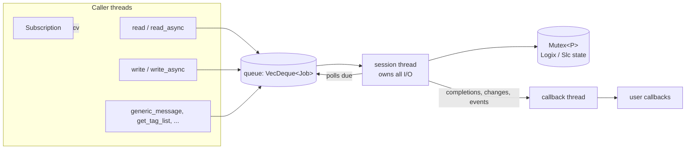

# Session core: async handles, a shared request queue and a tickler thread

Status: phase 1 of adding Siemens, Modbus and OPC UA to ciplink. Branch `feature/session-core`. Every step of the
[checklist](#implementation-checklist) is implemented: the Rust core, the simulator, the server, the C ABI, Python,
C++, .NET and the user guide ([Async, subscriptions and reconnect](../sessions.md)). Where the implementation had
to differ from the first draft, the text below says so and
[Changes made while implementing](#changes-made-while-implementing) lists why.

This page is for the engineers who build it. It is not part of the published wiki (`mkdocs.yml` excludes
`docs/dev/`). Every decision below is final for phase 1; the [checklist](#implementation-checklist) is the order of
work.

## Decisions at a glance

| Topic | Decision |
|---|---|
| Threads per driver | One **session thread** (the tickler) that does all I/O, started lazily on the first request, and one **callback thread** that runs every user callback, started lazily on the first callback. |
| Protocol state | Stays in a `Mutex<P>` inside the session. Only the session thread does I/O with it. Other threads lock it for accessors that do no I/O (`tags()`, `connection_size()`, ...); these wait for the request in flight, a background reconnect included. `connected()` and `target_connected()` read the connection's atomic flags instead and never wait. |
| Packing across callers | When the session thread takes work, it takes **every read at the head of the queue up to the first non-read** and issues them as one `read` of the merged tag list. The first caller's list goes in unchanged, so a caller alone sends exactly today's bytes. A tag asked for by two callers is read once. |
| Writes | Never merged and never reordered. A write, a closure or an open is a barrier: reads queued behind it wait for it. |
| Everything else | Runs as a closure `FnOnce(&mut P) -> Result<R>` on the session thread, so today's code is unchanged. |
| Async handle | `Handle<T>`: `wait`, `wait_timeout`, `try_take`, `on_complete`, and `impl Future`. No runtime dependency. Every handle completes exactly once. |
| Disconnected requests | **Fail fast.** While reconnecting, reads, writes and subscription polls fail at once with `CommError("not connected, reconnecting: <cause>")`. |
| Reconnect | On by default for `new()` and every binding. The first try is 100 ms after the loss, then the delay doubles up to 10 s. The failed request returns its error and is never sent again. Requests queued at the loss fail with the same error. `close()` stops reconnecting. A reconnect at an unchanged tag table version keeps the uploaded tag definitions. |
| `with_connector` | Keeps today's behaviour exactly: no reconnect and no keep-alive (`SessionOptions::off()`). The fixture, parity and differential tests use it, so they run unchanged. `with_session` takes explicit options. |
| Keep-alive | TCP keep-alive on every socket (idle 10 s, probe every 5 s). After 30 s idle the session thread sends Get Attribute Single, Identity, attribute 1 (Vendor ID): connected if a CIP connection is open, else unconnected. |
| Callbacks | Run on the callback thread, in order, never on the session thread and never on the caller's stack. Close or drop from inside a callback never joins its own thread. |
| Python | Every blocking call releases the GIL (as today), including handle waits, `Subscription` iteration, `close()` and the driver's drop. Callbacks take the GIL on the callback thread. |
| Shutdown | `close()`: fail the queued requests with `CommError("driver closed")`, end the subscriptions, let the request in flight finish, send Forward Close and UnRegister Session, then join the session thread. The driver can be opened again. `stop()` and drop do the same without the close packets and also join the callback thread. |
| The trait | `Protocol` (crate-private): `open`, `reopen`, `close`, `drop_link`, `connected`, `read`, `merges_reads`, `write`, `keep_alive`. The tag table check is Logix's own business, inside `reopen`. |
| SLC | Same session. `merges_reads()` is false: each caller's addresses are read as today, one request each, because one bad address fails a whole SLC read. |
| ciplink-server | Keeps its own worker. `LogixPlc` builds its driver with `reconnect: false` (keep-alive stays on). |

## Module layout

```text
crates/ciplink/src/session/
  mod.rs        SessionOptions, ConnectionState, ConnectionEvent, ConnectionCallback (pub);
                Protocol (pub(crate)); Session<P> (pub(crate)); the session-thread loop
  handle.rs     Handle<T> (pub), Completer<T> (pub(crate))
  dispatch.rs   Dispatcher: the callback thread (pub(crate))
  batch.rs      Job<P>, take_batch, merge_reads / split_reads (pub(crate), pure functions)
  subscribe.rs  Subscription, SubscribeOptions, Changes (pub); polling, diff and deadband (pub(crate))
```

`lib.rs` gets `pub mod session;`. `impl Protocol for Logix` lives in `logix/driver.rs` and `impl Protocol for Slc`
in `slc/driver.rs`. A later Modbus, S7comm or OPC UA codec is a new state type that implements `Protocol` and
a thin driver struct around `Session<ThatState>`.



### The trait

```rust
/// What a protocol's state gives the session. Every method runs on the session thread with the state locked,
/// except `connected`, which accessors may also call.
pub(crate) trait Protocol: Send + 'static {
    /// The user's `open()`: connect and initialise. Ok(false) if the target refused the session.
    fn open(&mut self) -> Result<bool>;
    /// A background reconnect after the link was lost. Defaults to `open`; Logix keeps its tag definitions
    /// when the tag table version is unchanged.
    fn reopen(&mut self) -> Result<bool> {
        self.open()
    }
    /// The user's `close()`: the protocol's closing requests, then drop the link.
    fn close(&mut self) -> Result<()>;
    /// Forget the link without sending anything (after a panic in the middle of a request).
    fn drop_link(&mut self);
    /// True while the link is up (a session is registered, for CIP).
    fn connected(&self) -> bool;
    /// Read tags: one result per tag in order; Err fails the whole call.
    fn read(&mut self, tags: &[&str]) -> Result<Vec<TagResult>>;
    /// True if one read of several callers' tags gives each caller what its own read would. Default true.
    fn merges_reads(&self) -> bool {
        true
    }
    /// Write tags: one result per item in order; Err fails the whole call.
    fn write(&mut self, items: &[(&str, Value)]) -> Result<Vec<TagResult>>;
    /// The cheap request sent when the link has been idle for `SessionOptions::keep_alive`.
    fn keep_alive(&mut self) -> Result<()>;
}
```

Why no separate tag-table-changed method: the session never needs it. Logix already checks the version inside
`read` and `write` and in `reopen`. A Logix check has to run on the new connection between session registration
and the tag upload, which is inside `initialize_driver`, so it stays there.

## Public Rust API

All new public types are in `ciplink::session`. Existing signatures do not change.

### Options, states and events

```rust
/// Reconnect and keep-alive settings of a driver's session.
#[derive(Clone, Debug, PartialEq, Eq)]
pub struct SessionOptions {
    /// Reconnect in the background after an open link is lost. Default true.
    pub reconnect: bool,
    /// Delay before the first reconnect attempt; doubled after each failed attempt. Default 100 ms.
    pub reconnect_min: Duration,
    /// Longest delay between attempts. Default 10 s.
    pub reconnect_max: Duration,
    /// Send the keep-alive request after this long without traffic; None never sends it. Default Some(30 s).
    pub keep_alive: Option<Duration>,
}

impl Default for SessionOptions { /* true, 100 ms, 10 s, Some(30 s) */ }

impl SessionOptions {
    /// No reconnect and no keep-alive: the behaviour of a driver before sessions (`with_connector` uses it).
    pub fn off() -> Self; // reconnect: false, keep_alive: None, the delays as Default
}

/// Where the link is.
#[derive(Clone, Copy, Debug, PartialEq, Eq)]
pub enum ConnectionState {
    /// Never opened, closed by the user, or lost with reconnect off. Requests run as before (and fail as before).
    Closed,
    /// Opened, and not lost since.
    Connected,
    /// Lost; reconnecting in the background. Reads, writes and polls fail fast.
    Reconnecting,
}

/// A change of the link, delivered on the callback thread in order.
#[derive(Clone, Debug, PartialEq)]
pub enum ConnectionEvent {
    /// `open()` succeeded, or a reconnect did.
    Connected,
    /// An open link was lost; `error` is what failed (the request's CommError, or the keep-alive's).
    Disconnected { error: Error },
    /// Reconnect attempt `attempt` (1, 2, ...) is due after `delay`.
    Reconnecting { attempt: u32, delay: Duration },
}

/// The connection-state callback.
pub type ConnectionCallback = Box<dyn Fn(&ConnectionEvent) + Send + Sync + 'static>;
```

The events of one outage are `Disconnected`, then `Reconnecting { 1, 100 ms }`, then `Reconnecting { 2, 200 ms }`
after the first attempt fails, and so on, then `Connected`. `close()` emits nothing, and neither does a failed
user `open()`, because the caller already has the result.

### Handle

```rust
/// The result of a request that is queued or in flight. Dropping it does not cancel the request (a queued
/// write still runs); the result is discarded.
pub struct Handle<T> { /* Arc<Slot<T>> */ }

impl<T: Send + 'static> Handle<T> {
    /// Blocks until the result is in. Err(Request "result already taken") if try_take/wait_timeout took it.
    pub fn wait(self) -> Result<T>;
    /// Blocks up to `timeout`: Some(result) once it is in (taking it), None on timeout (the handle stays usable).
    pub fn wait_timeout(&self, timeout: Duration) -> Option<Result<T>>;
    /// The result if it is in, taking it; None if not yet in, or already taken.
    pub fn try_take(&self) -> Option<Result<T>>;
    /// True once the result is in (taken or not).
    pub fn is_done(&self) -> bool;
    /// Calls `f` with the result on the callback thread: later, or soon if it is already in. Never on the
    /// calling thread's stack.
    pub fn on_complete(self, f: impl FnOnce(Result<T>) + Send + 'static);
}

impl<T: Send + 'static> Future for Handle<T> {
    type Output = Result<T>;
    // poll: takes the result if in; else stores cx.waker() (replacing an older one) and returns Pending.
}
```

Inside, `Slot<T>` is a `Mutex<SlotState<T>>` plus a `Condvar`. `SlotState` holds `result: Option<Result<T>>`,
`taken: bool`, `waker: Option<Waker>`, `callback: Option<Box<dyn FnOnce(Result<T>) + Send>>` and the
`Dispatcher` that `on_complete` posts to. `Completer<T>` is the session's half. `complete(result)` locks the slot.
If a callback is set, it posts `(callback, result)` to the callback thread. Otherwise it stores the result, takes
the waker and calls `notify_all`. It then unlocks and calls `waker.wake()`. **Wakers are woken on the session
thread**: the `Waker` contract requires `wake` to be cheap and non-blocking. If a `Completer` is dropped without
completing (a bug or a panic), its `Drop` completes it with `CommError("request dropped")`, so no waiter can hang.

### Driver methods (Logix; SLC has the same new methods)

```rust
impl LogixDriver {
    pub fn new(path: &str, options: LogixOptions) -> Result<Self>;                         // TCP, SessionOptions::default()
    pub fn with_connector(path: &str, options: LogixOptions, connector: Connector) -> Result<Self>; // SessionOptions::off()
    pub fn with_session(path: &str, options: LogixOptions, session: SessionOptions, connector: Connector) -> Result<Self>;

    // unchanged signatures, now enqueue-and-wait
    pub fn read(&self, tags: &[&str]) -> Result<Vec<TagResult>>;            // = self.read_async(tags).wait()
    pub fn write(&self, items: &[(&str, Value)]) -> Result<Vec<TagResult>>; // = self.write_async(items).wait()

    // new
    pub fn read_async(&self, tags: &[&str]) -> Handle<Vec<TagResult>>;
    pub fn write_async(&self, items: &[(&str, Value)]) -> Handle<Vec<TagResult>>;
    pub fn subscribe(&self, tags: &[&str], options: SubscribeOptions) -> Result<Subscription>;
    pub fn set_connection_callback(&self, callback: Option<ConnectionCallback>);
    pub fn connection_state(&self) -> ConnectionState;   // never blocks on I/O
    /// Stops the session and callback threads and fails pending requests without closing the connection
    /// (what drop does). The next request starts the session thread again.
    pub fn stop(&self);
}

impl SlcDriver {
    pub fn new(path: &str, options: CipOptions) -> Result<Self>;                            // SessionOptions::default()
    pub fn with_connector(path: &str, options: CipOptions, connector: Connector) -> Result<Self>; // SessionOptions::off()
    pub fn with_session(path: &str, options: CipOptions, session: SessionOptions, connector: Connector) -> Result<Self>;
    // read_async, write_async, subscribe, set_connection_callback, connection_state, stop: as Logix
}
```

`LogixOptions` gets no new field: the tests build it with exhaustive struct literals. `set_connection_callback`
replaces the callback. Once it returns, the old callback is not running and will not be called again, unless the
call came from the callback thread itself.

Errors and messages, all existing variants:

| Case | Error |
|---|---|
| Request queued when `close()`, `stop()` or drop ran | `Error::Comm("driver closed")` |
| Read, write or poll while reconnecting | `Error::Comm(format!("not connected, reconnecting: {cause}"))`, `cause` being the Disconnected error. No attempt count, so the text stays the same during an outage and a subscription reports it once. |
| A panic inside a job | `Error::Comm(format!("internal error: {panic message}"))`; the link is dropped (`drop_link`), the session keeps running. A blocking `wait` (every sync method) resumes the panic on the caller's thread instead, as a call panicked before sessions; `try_take`, `wait_timeout`, `.await` and `on_complete` get the CommError |
| A blocking wait on the session thread (a Python log handler or send hook calling back into the driver) | `Error::request("cannot wait for the driver on its own session thread")`, returned at once instead of deadlocking |

## The session thread

```rust
pub(crate) struct Session<P: Protocol> { shared: Arc<Shared<P>> }

struct Shared<P> {
    state: Mutex<P>,          // the protocol state
    queue: Mutex<Queue<P>>,   // jobs, subscriptions, link state, timers
    wake: Condvar,            // on `queue`
    options: SessionOptions,
    dispatcher: Dispatcher,
    close_lock: Mutex<()>,    // one close/stop at a time
}

struct Queue<P> {
    jobs: VecDeque<Job<P>>,
    subscriptions: Vec<Arc<SubShared>>,
    state: ConnectionState,
    cause: Option<Error>,          // the Disconnected error, while Reconnecting
    attempt: u32,
    retry_at: Option<Instant>,
    last_activity: Instant,        // last request on the link
    thread: Option<JoinHandle<()>>,// Some while the session thread runs
    thread_id: Option<ThreadId>,
    stopping: Option<Stop>,        // Stop::Close(Completer<()>) or Stop::Drop
    events: Option<Arc<dyn Fn(&ConnectionEvent) + Send + Sync>>,
}

pub(crate) enum Job<P> {
    Read { tags: Vec<String>, done: Completer<Vec<TagResult>> },
    Poll { sub: Arc<SubShared> },                    // a subscription read; packed like Read
    Write { items: Vec<(String, Value)>, done: Completer<Vec<TagResult>> },
    Open { done: Completer<bool> },
    Call(Box<dyn FnOnce(&mut P) + Send>),            // completes its own Completer inside
}

impl<P: Protocol> Session<P> {
    pub(crate) fn new(protocol: P, options: SessionOptions) -> Self;
    pub(crate) fn lock(&self) -> MutexGuard<'_, P>;  // accessors only: no I/O under it
    pub(crate) fn open(&self) -> Handle<bool>;
    pub(crate) fn close(&self) -> Result<()>;
    pub(crate) fn stop(&self);
    pub(crate) fn read(&self, tags: &[&str]) -> Handle<Vec<TagResult>>;
    pub(crate) fn write(&self, items: &[(&str, Value)]) -> Handle<Vec<TagResult>>;
    pub(crate) fn call<R: Send + 'static>(
        &self,
        f: impl FnOnce(&mut P) -> Result<R> + Send + 'static,
    ) -> Handle<R>;
    pub(crate) fn subscribe(&self, tags: &[&str], options: SubscribeOptions) -> Result<Subscription>;
    pub(crate) fn set_connection_callback(&self, callback: Option<ConnectionCallback>);
    pub(crate) fn state(&self) -> ConnectionState;
}
impl<P: Protocol> Drop for Session<P> { fn drop(&mut self) { self.stop() } }
```

`lock()` recovers a poisoned mutex the way `LogixDriver::lock` does today: `drop_link()`, then `clear_poison`.

**Submit** (caller thread). Lock `queue`. If the current thread is the session thread, complete with the
"own session thread" error. If `stopping` is set, complete with "driver closed". If the state is `Reconnecting` and
the job is a Read, Write or Poll, complete with the reconnecting error. Otherwise push the job to the back, start
the session thread if `thread` is None, and `notify_one`.

**Loop** (session thread):

```text
loop {
    lock queue
    loop {
        if stopping: break Stop
        now = Instant::now()
        drop closed subscriptions; push a Poll for each due subscription that has none queued or in flight
            (only while state != Reconnecting)
        if a batch can be taken (take_batch): break Batch
        if state == Reconnecting and now >= retry_at: break Reconnect
        if state == Connected and keep_alive is Some(k) and now - last_activity >= k: break KeepAlive
        wait on `wake` until the earliest of: next poll due, retry_at, last_activity + k (or forever)
    }
    unlock queue
    run the work with `state` locked, inside catch_unwind (see below), then unlock state
    complete handles and deliver subscription results (no lock held but the slot's / subscription's own)
    lock queue: update last_activity, detect a lost link, schedule the next attempt, emit events
}
```

**Lost link.** After any Batch or KeepAlive, while `state` is still locked, the session thread reads
`p.connected()`. If the queue's state was `Connected` and `connected()` is now false, the link is lost:

1. `cause` = the job's error if it was an `Error::Comm`, else `Error::comm("connection lost")`.
2. Fail every queued Read, Write and Poll with the reconnecting error (or with `cause` itself when reconnect is
   off). Queued Open and Call jobs stay and run.
3. Give every subscription a `Changes` with each tag failed (`TagError` kind `Comm`, message `cause`).
4. Emit `Disconnected { error: cause }`.
5. With reconnect on: state = `Reconnecting`, attempt = 1, `retry_at = now + reconnect_min`, emit
   `Reconnecting { 1, reconnect_min }`. With reconnect off: state = `Closed`.

**Reconnect attempt.** `p.reopen()`. On Ok(true): state = `Connected`, attempt = 0, `cause` = None, every
subscription is due now, emit `Connected`. On Ok(false) or Err: attempt += 1,
`delay = min(reconnect_min * 2^(attempt-1), reconnect_max)`, `retry_at = now + delay`, emit
`Reconnecting { attempt, delay }`. There is no attempt limit; only `close()`, `stop()` or drop end it.

**Open job.** `p.open()`. On Ok(true), from any state: state = `Connected`, reset the attempts, emit `Connected`
(only when the state was not already `Connected`: opening an open driver emits nothing).
On Ok(false) or Err: the state does not change, so a reconnect in progress carries on and a closed driver stays
closed. A user `open()` that fails never starts reconnecting; only the loss of a link that was up does.

**Panics.** Each job, poll batch, keep-alive and reconnect attempt runs as
`catch_unwind(AssertUnwindSafe(|| ...))` *inside* the state guard, so the mutex is not poisoned. On a panic: call
`p.drop_link()` (a reply may be unread), complete the job's handles with the internal-error CommError (carrying the
panic payload for a blocking `wait` to resume; with several merged reads the first Read caller gets it), log it at
error level, and carry on. If the queue state was `Connected`, the lost-link steps follow, because
`connected()` is now false. A `call` closure catches its own panic and drops the link itself before completing its
handle.

**Completion order.** The session thread updates the queue (activity, connection state, lost-link steps, events)
*before* it completes the batch's handles and delivers its polls, so a caller that has its result also sees the
connection state that result left (`read` fails, then `connection_state()` is already `Reconnecting`). A `call`
completes its handle itself, so after a `call` that lost the link the state catches up a moment later; its cause is
`CommError("connection lost")` because the session does not see the closure's error.

**Lock rules.** No thread holds `queue` and `state` at the same time. Accessors lock `state` only; submit and close
lock `queue` only; the session thread locks one, then releases it, then the other. Slot and subscription locks are
taken alone, or as subscription `call` lock first, then the subscription state.

## How reads are merged and split

`batch.rs`, pure and unit-tested:

```rust
/// The jobs the session thread runs next: every Read or Poll at the head of the queue up to the first other
/// job, or that one other job alone.
pub(crate) fn take_batch<P>(jobs: &mut VecDeque<Job<P>>) -> Vec<Job<P>>;

/// The tag list read for several callers, and where each caller's tags are in it. The first list goes in
/// unchanged (duplicates included); a later caller's tag already in the list reuses its first position.
pub(crate) fn merge_reads(lists: &[&[String]]) -> (Vec<String>, Vec<Vec<usize>>);

/// Each caller's results (cloned from `results` by position), or each caller the same error.
pub(crate) fn split_reads(
    results: Result<Vec<TagResult>>,
    positions: &[Vec<usize>],
) -> Vec<Result<Vec<TagResult>>>;
```

When `p.merges_reads()` is true (Logix): merge, call `p.read(&merged)` once, split, complete each Read and deliver
each Poll. When it is false (SLC): call `p.read` once per job, in queue order, all inside the same state lock.

Example. A caller asks for `["a", "b", "a"]`, then `["b", "c"]`, then a subscription poll for `["c", "d"]`.
`merged = ["a", "b", "a", "c", "d"]`, with positions `[[0, 1, 2], [1, 3], [3, 4]]`. The first caller alone would
send `["a", "b", "a"]`, its own list, so its bytes are today's bytes.

This is safe for Logix because `Logix::read_tags` puts per-tag failures in their results (a bad name is that tag's
`BadRequest`). Its `Err` is only for a connection failure, a failed Forward Open or a Comm error while resolving a
lazy tag, which would fail every caller anyway. The tag-table-changed retry inside `read_tags` covers the merged
list once. There is no cap on the merged list: the packer splits it into packets as it does a long read today.

There is no coalescing delay: a lone request goes out at once. Merging happens only when requests queue up while
the session thread is busy, as with libplctag.

## How writes are ordered

The queue is FIFO and `take_batch` never takes a read from behind a non-read job. So a write runs after
everything queued before it and before everything queued after it, and a caller that writes then reads reads its
own write. Writes from different callers are not merged: their error semantics (version checks before and after
each call, never retried) are per call, and merging would change the bytes. A write whose link is lost returns
its error and is never sent again. Requests queued behind it fail (see [Lost link](#the-session-thread)).

## Closures: how every existing method maps

`call` boxes the closure with its `Completer`. Arguments are moved in, so a borrowed argument is cloned or turned
into a `String` first (`GenericMessage` is `Clone`).

| Path | `LogixDriver` methods |
|---|---|
| `session.open()` then `wait` | `open` |
| `session.close()` | `close` |
| `session.read` / `write` then `wait` | `read`, `write` |
| `session.call(...)` then `wait` | `generic_message`, `send_connected_raw`, `send_unconnected_raw`, `get_module_info`, `identity_at`, `app_at`, `ports_at`, `get_plc_info`, `get_plc_name`, `get_plc_time`, `set_plc_time`, `get_tag_list`, `check_tag_table`, `get_tag_info`, `get_tag_info_py` (a lazy tag may need I/O), `get_tag_description`, `get_tag_descriptions`, `authenticate_metadata` |
| `call` to build, then run on the caller | `browse_port`, `scan_port` (`conn.scan(...)` in the closure returns a `Scan`, which is `Send`; `Scan::run` and the user's `found` stay on the caller), `trend` (pen targets and the trend's `CipConnection` in the closure; the trend's own connection and worker as today) |
| `session.lock()` (no I/O) | `connected`, `connection_size`, `set_connection_size`, `socket_timeout`, `set_socket_timeout`, `name`, `revision_major`, `micro800`, `use_instance_ids`, `set_use_instance_ids`, `tag_table_version`, `tags`, `set_tags`, `share_tags_from`, `definitions`, `definitions_since`, `data_types`, `aoi_probe`, `tags_py`, `data_types_py`, `tag_list_py`, `info_py`, `advance_clock`, `Display` |
| unchanged (no driver state) | `list_identity`, `discover`, `definitions_version` |

`pub(crate) fn lock(&self)` on `LogixDriver` becomes `self.session.lock()`. Its callers in `rw.rs`,
`descriptions.rs` and `trend.rs` that do I/O switch to `self.session.call(...)`. `get_plc_time` builds its reply
in the closure; the result shaping stays as it is. `authenticate_metadata` wraps its `Result` into the
`TagResult` after `wait`.

## Where callbacks run, and why nothing deadlocks

The **callback thread** (`Dispatcher`, thread name `ciplink-callbacks`) is a `std::sync::mpsc` channel of
`Box<dyn FnOnce() + Send>` tasks. Its sender sits in `Mutex<Option<Sender>>`, and the thread starts on the first
post. It runs `on_complete` callbacks, subscription deliveries and connection events, in the order they were
posted, each inside `catch_unwind` (a panic is logged at error level and the thread carries on).

Rules, and the deadlock each one prevents:

1. **No user code on the session thread.** User code can only reach it through the Python log bridge and the
   Python send hook (test tooling), which run Python on the session thread. So the session thread never waits for
   user code, and I/O never waits for a callback.
2. **A callback may call the driver.** A sync `read` from a callback enqueues and waits on its own handle's
   condvar; the session thread serves it. `read_async(...).on_complete(...)` from a callback posts the inner
   callback, which runs after the current one returns.
3. **A wait on the session thread fails at once** with the "own session thread" error. Without this, a Python
   logging handler calling `plc.read()` would deadlock the thread on itself.
4. **Close, stop or drop never join the current thread.** From a callback, the callback thread is not joined; it
   exits after the current callback returns. From the session thread (only possible through Python hooks), the
   session thread is not joined.
5. **Unsubscribe and replacing the connection callback wait for a callback in progress** (subscription `call`
   lock) unless they run on the callback thread. That is what lets the C, C++ and C# bindings free `user_data`
   safely after `ciplink_subscription_free` or `ciplink_set_connection_callback` returns.
6. **Python and the GIL.** Every ciplink-py method that can block runs inside `py.detach` (it already does for
   I/O), and so do `Handle` waits, `Subscription.recv`, `close` and `stop`. Python callbacks take the GIL on the
   callback thread with `Python::attach`. Dropping a `_core` driver is the dangerous case: PyO3 runs `Drop` with
   the GIL held, and the drop joins threads that may be waiting for the GIL (a pending Python callback, or a log
   record on the session thread). So `PyLogixDriver`/`PySLCDriver` implement `Drop` as
   `Python::attach(|py| py.detach(|| self.inner.stop()))`. The field's own drop then has nothing left to join.
7. **A waker or a `Completer` never blocks**: completion holds only the slot lock and posts to a channel.

The one way left to deadlock yourself in Rust: dropping or closing the driver while holding a lock that your own
callback is waiting for. That is documented on `close`, `stop` and the callback setters.

## Reconnect

Who starts it: only the loss of a link that was `Connected` (opened by `open()` or by an earlier reconnect). See
[The session thread](#the-session-thread) for the state machine, the events and what happens to queued requests.

While `Reconnecting`, the following holds:

- Reads, writes and polls fail fast with `CommError("not connected, reconnecting: <cause>")`. A caller gets bad
  quality at once instead of waiting through attempts that can take `socket_timeout` each. Callers that would
  rather wait can wait for the `Connected` event.
- Other calls (`get_tag_list`, `generic_message`, ...) still run. Without a link they fail with their usual
  CommError (`failed to send message` or "A session must be registered ..."). They cannot open a connection by
  accident: only `Logix::open`/`reopen` call `CipConnection::open`.
- A user `open()` runs an attempt at once (it is an Open job); success ends the outage.
- `close()` and `stop()` end it.

**Logix `reopen`, keeping the tag definitions.** `Logix::open` stays exactly as it is (`reset_lazy_tags` when
lazy, then `initialize_driver`), so a user's close then open sends today's bytes. `initialize_driver` gets one
parameter, `reconnect: bool`:

```rust
fn initialize_driver(&mut self, reconnect: bool) -> Result<()> {
    // identity, plc_info, serial check, get_plc_name, instance IDs, tag table version: unchanged
    let unchanged = reconnect
        && same_serial                       // already computed for the template cache
        && version.is_some()
        && version == self.tag_table_version;
    if reconnect && self.args.lazy_tags && !unchanged {
        self.reset_lazy_tags();
        self.tag_table_version = version;
    }
    if self.args.init_tags && !unchanged {
        // load_tag_list as today
    }
}

impl Protocol for Logix {
    fn reopen(&mut self) -> Result<bool> {
        if self.conn.connected() { return Ok(true); }
        if !self.conn.open()? { return Ok(false); }
        if let Err(err) = self.initialize_driver(true) {
            let _ = self.conn.close(); // as open() does
            return Err(err);
        }
        Ok(true)
    }
}
```

A controller that does not report its version (old firmware, Micro800) has `version == None`, so it uploads
again. That is safe. The tag cache file still saves that upload when it is configured. Metadata authentication
is per CIP connection and is not redone: callers that need it call `authenticate_metadata` again on `Connected`.
A running `Trend` uses its own connection and is not restarted; it fails on its own as today.

## Keep-alive

**TCP.** In `TcpTransport::connect`, after `set_nodelay`:

```rust
let keepalive = socket2::TcpKeepalive::new()
    .with_time(Duration::from_secs(10))
    .with_interval(Duration::from_secs(5));
if let Err(err) = socket2::SockRef::from(&stream).set_tcp_keepalive(&keepalive) {
    log::debug!("TCP keep-alive not set: {err}"); // not a reason to fail the connect
}
```

`socket2` 0.6 is already a dependency. `with_retries` is left out because it is not available on Windows. The OS
probe count (10 on Windows, 9 on Linux) then declares a dead peer after about a minute. The transport doc comment
"a TCP connection with keep-alive" becomes true.

**The idle request.** After `keep_alive` (default 30 s) with no request on the link, and only while `Connected`,
the session thread calls `p.keep_alive()`. `last_activity` is updated after every batch, call, open,
keep-alive and successful reconnect, so a busy driver or a polling subscription never sends it. Both Logix and
SLC call one new `CipConnection` method:

```rust
/// Get Attribute Single (0x0E), Identity (class 0x01) instance 1, attribute 1 (Vendor ID): a 2-byte reply
/// every CIP device has.
const KEEP_ALIVE_REQUEST: [u8; 8] = [0x0E, 0x03, 0x20, 0x01, 0x24, 0x01, 0x30, 0x01];

/// The idle request: connected (next sequence count) while the CIP connection is open, which also resets the
/// connection's inactivity watchdog; unconnected (SendRRData, straight to the message router) with only a
/// session; nothing without one. The reply's status is ignored: any reply proves the link. A transport failure
/// drops the connection as every request does.
pub(crate) fn keep_alive(&mut self) -> Result<()>;
```

Why 30 s and this request:

- Our Forward Open asks for RPI 0x00204001 µs (2.11 s) with timeout multiplier 7 (x512), about 18 minutes before
  the target closes an idle CIP connection.
- Devices that implement the TCP/IP object's encapsulation inactivity timeout (attribute 13) default to
  120 s. Firewalls and NAT often drop idle TCP flows after a few minutes.
- 30 s is well inside all of these. It also finds a dead link within about `30 s + socket_timeout` while idle, so
  `Disconnected` fires and the reconnect starts before the next user request.
- Encapsulation NOP is not used: real devices do not answer it, but ciplink-sim answers unknown commands, which
  would leave a reply in the stream. Logix, Micro800, SLC and the simulator all answer Identity
  Get Attribute Single.
- The connected request takes a sequence count. That cannot change parity: keep-alive is off in
  `with_connector`, and the tests that use `with_session` run for less than 30 s.

## Subscriptions

```rust
#[derive(Clone, Debug, PartialEq)]
pub struct SubscribeOptions {
    /// Poll period. Default 1 s. Must be > 0.
    pub interval: Duration,
    /// Numeric tags: a change smaller than this (absolute) since the last delivered value is not delivered.
    /// None delivers every change. Default None.
    pub deadband: Option<f64>,
}

/// The tags of one subscription that changed in one poll.
#[derive(Clone, Debug, PartialEq)]
pub struct Changes {
    /// When the poll completed.
    pub time: SystemTime,
    /// The changed tags, in subscription order. Quality is the result's `error`: None is good, Some is failed
    /// with that error (kind Comm for a whole-call failure or a lost link).
    pub results: Vec<TagResult>,
}

/// A running subscription; dropping it (or `close`) unsubscribes.
pub struct Subscription { shared: Arc<SubShared> }

impl Subscription {
    pub fn tags(&self) -> &[String];
    /// Blocks until changes are pending (taking all of them), or the subscription ends (None).
    pub fn recv(&self) -> Option<Changes>;
    /// recv with a timeout: None on timeout or end; tell them apart with is_closed().
    pub fn recv_timeout(&self, timeout: Duration) -> Option<Changes>;
    /// The pending changes, if any, without blocking.
    pub fn try_recv(&self) -> Option<Changes>;
    /// Delivers pending and later changes to `f` on the callback thread instead of recv (replaces an earlier f).
    pub fn on_changes(&self, f: impl Fn(Changes) + Send + Sync + 'static);
    /// True once unsubscribed, or the driver was closed, stopped or dropped.
    pub fn is_closed(&self) -> bool;
    /// Unsubscribes; returns once a callback in progress has returned (unless called from the callback thread).
    pub fn close(&self);
}
```

`subscribe` returns `Err(Error::request(..))` for an empty tag list or a zero interval. It does no I/O.

**Polling.** The first poll is queued at once, so the first values come quickly, and subscriptions made together
share one merged read. Later polls are due at `start + phase + k * interval` for k >= 1, with
`phase = interval * (r / u64::MAX)` and `r` a random `u64` from `getrandom` (already a dependency). That spreads
the polls of subscriptions with the same interval so they do not all fall due at the same instant. `phase` is a
pure function, unit-tested with a fixed `r`. A
subscription with a poll still queued or in flight is not polled again, and a missed period is skipped: `next`
moves on by whole intervals to the first one after now, so the phase is kept. Polls are `Job::Poll` entries in the same queue, so they merge with other
callers' reads and wait behind writes. No polls are made while `Reconnecting`. When the link comes up (`open()` or
a reconnect) one poll of every subscription is queued at once; their due times are left alone, so each keeps its
phase.

**Changes.** On the session thread, for each tag result: deliver it if there is no last delivered result, or the
`error` changed, or the `data_type` changed, or the `value` changed. When `deadband` is set and both values are
numeric (`Value::as_f64`), a value change is delivered only if `|new - last| >= deadband`; the comparison is
always with the last *delivered* value, so slow drift still gets through. A whole-call `Err` becomes a failed
result per tag (kind Comm, the error's message). A REAL NaN compares unequal and is delivered every poll; that is
accepted.

**Delivery and coalescing.** Changed results go into the subscription's `pending: IndexMap<usize, TagResult>`
(tag index to latest result), so a slow consumer gets the latest state of each tag and memory stays bounded by
the tag count. In recv mode, a condvar wakes `recv`. In callback mode, a delivery task is posted once while
`pending` is non-empty. The task takes the `call` lock, takes `pending` as one `Changes`, calls `f`, and releases
the lock.

**End.** Drop or `close` marks it closed (the session thread drops it at its next pass) and waits for a callback
in progress. The driver's `close()`, `stop()` and drop end every subscription: `recv` returns what is still
pending, then None.

## Shutdown

`close()`, holding `close_lock`:

1. Lock `queue`. If no session thread is running: unlock, lock `state`, `p.close()`, end the subscriptions,
   return that result.
2. Set `stopping = Stop::Close(completer)`, take every queued job, end every subscription, notify. Unlock.
3. Fail the taken jobs with `CommError("driver closed")`.
4. The session thread finishes the work in hand (it holds no queue lock during I/O), sees `stopping`, runs
   `p.close()` (today's Forward Close and UnRegister Session), sets state `Closed`, clears `thread` and
   `stopping`, completes the close handle with that result, and returns.
5. `close()` waits for that handle, joins the session thread (unless it runs on it), and returns `p.close()`'s
   result.

Requests made after `close()` start a new session thread, so `open()` again works as today, and a request without
`open()` fails as today. The callback thread keeps running across `close()`.

`stop()` and `Drop`: the same as close, with `Stop::Drop`. The session thread exits **without** the close
packets: the transport is dropped with the state, as a dropped driver closes its socket today. Then the
dispatcher's sender is dropped and the callback thread joined (unless `stop` runs on it), after it has run every
task already posted, including the "driver closed" completions. **When drop returns, no callback of that driver
will run again**; from the callback thread itself, the remaining ones run after the current callback returns.
`stop()` is idempotent. A request after `stop()` starts the session thread again, and the callback thread starts
again on its next post.

## SLC

```rust
/// The SLC driver's state: the connection (behind CipDriver, so `cip()` keeps working) and the vsn.
pub(crate) struct Slc { cip: Arc<CipDriver>, vsn: Arc<Mutex<[u8; 4]>> }

pub struct SlcDriver { cip: Arc<CipDriver>, session: Session<Slc> }   // cip() returns &self.cip

impl Protocol for Slc {
    fn open(&mut self) -> Result<bool>          { self.cip.open() }               // session only, as today
    fn close(&mut self) -> Result<()>           { self.cip.close() }
    fn drop_link(&mut self)                     { self.cip.lock().drop_connection() }
    fn connected(&self) -> bool                 { self.cip.connected() }
    fn read(&mut self, a: &[&str]) -> Result<Vec<TagResult>>       { /* today's SlcDriver::read body */ }
    fn merges_reads(&self) -> bool              { false }
    fn write(&mut self, i: &[(&str, Value)]) -> Result<Vec<TagResult>> { /* today's write body */ }
    fn keep_alive(&mut self) -> Result<()>      { self.cip.lock().keep_alive() }
}
```

- `read` and `write` move from `impl SlcDriver` into `impl Slc` unchanged: the helpers take `&Slc` for the
  requestor instead of `&SlcDriver`.
- `merges_reads` is false because `SlcDriver::read` fails the whole call with a RequestError at a bad address,
  after reading the addresses before it. Merging would let one caller's typo fail another caller's read, and
  merging gains nothing anyway: PCCC sends one request per address. Concurrent callers still share one session
  and get one tickler wake, run in order.
- `get_processor_type`, `get_datalog_queue` and `get_file_directory` become `call`s with today's bodies.
- New delegating methods that go through the session (`call`): `generic_message`, `send_connected_raw`,
  `send_unconnected_raw`, `get_module_info`, `identity_at`, `app_at`, `ports_at`, `browse_port`, `scan_port`.
  Accessors (`target_connected`, `connection_size`, `set_connection_size`, `socket_timeout`, `set_socket_timeout`)
  go straight to the connection: `SlcDriver` and `Slc` share one `Arc<CipDriver>`, whose own lock is the one that
  matters (the session thread holds it during I/O). ciplink-ffi and ciplink-py switch from `d.cip().x()` to these
  in the binding stage.
- `cip()` stays for compatibility and the tests. Its doc says it bypasses the session queue: calls through it
  serialize on the connection's mutex against the session thread, are not packed and do not reconnect. The
  existing warning stays (holding its guard while calling an `SlcDriver` method deadlocks).
- Lock order: the session thread locks `Slc` (session state), then `cip`; `cip()` users lock `cip` only.

## ciplink-server

`LogixPlc::new` builds its driver with
`LogixDriver::with_session(&cfg.path, options, SessionOptions { reconnect: false, ..Default::default() }, tcp_connector())`.
The worker stays the only thing that reconnects, and `Plc::read` keeps returning `Err` on a lost link as its
contract says. Keep-alive stays on: a lost link found while idle makes the next worker read fail, which starts
the worker's reconnect. Nothing else in the server changes. The server's own subscriptions and planner stay as
they are; moving them onto core subscriptions is later work.

## C ABI

`crates/ciplink-ffi/src/lib.rs`, header regenerated with
`cd crates/ciplink-ffi && cbindgen --config cbindgen.toml --crate ciplink-ffi --output include/ciplink.h`
(cbindgen is in `~/.cargo/bin`).

```c
typedef struct CiplinkRequest CiplinkRequest;            /* opaque */
typedef struct CiplinkSubscription CiplinkSubscription;  /* opaque */

typedef enum CiplinkConnectionState {
    CIPLINK_CONNECTION_STATE_CLOSED = 0,
    CIPLINK_CONNECTION_STATE_CONNECTED = 1,
    CIPLINK_CONNECTION_STATE_RECONNECTING = 2,
} CiplinkConnectionState;

/* CiplinkStatus gains: */
/*   CIPLINK_STATUS_TIMEOUT = 8   ciplink_request_wait timed out (the request carries on) */

/* status OK: `json` is the result array (as ciplink_read returns); else it is the error message.
   Valid only during the call. */
typedef void (*CiplinkDone)(void *user, CiplinkStatus status, const char *json);
/* `results_json`: the changed tags as a result array. Valid only during the call. */
typedef void (*CiplinkChanges)(void *user, const char *results_json);
/* {"event":"connected"} | {"event":"disconnected","error":"..."} |
   {"event":"reconnecting","attempt":3,"delay":0.4}   (delay in seconds) */
typedef void (*CiplinkConnectionCallback)(void *user, const char *event_json);

CiplinkStatus ciplink_read_async(const CiplinkDriver *handle, const char *const *tags, size_t count,
                                 CiplinkDone done, void *user, CiplinkRequest **out_request);
CiplinkStatus ciplink_write_async(const CiplinkDriver *handle, const char *items_json,
                                  CiplinkDone done, void *user, CiplinkRequest **out_request);
bool          ciplink_request_done(const CiplinkRequest *request);
CiplinkStatus ciplink_request_wait(const CiplinkRequest *request, int64_t timeout_ms, char **out_json);
void          ciplink_request_free(CiplinkRequest *request);

CiplinkStatus ciplink_subscribe(const CiplinkDriver *handle, const char *const *tags, size_t count,
                                const char *options_json, CiplinkChanges on_changes, void *user,
                                CiplinkSubscription **out_subscription);
void          ciplink_subscription_free(CiplinkSubscription *subscription);

CiplinkStatus ciplink_set_connection_callback(const CiplinkDriver *handle, CiplinkConnectionCallback callback,
                                              void *user);
CiplinkConnectionState ciplink_connection_state(const CiplinkDriver *handle);
```

Semantics:

- `*_async`: `done` and `out_request` may each be NULL. A non-OK return means bad arguments or an unsupported
  driver (`CIPLINK_STATUS_UNSUPPORTED` for the plain CIP driver). Then nothing was queued and `done` is never
  called. Otherwise `done` is called exactly once on the driver's callback thread, possibly before
  `ciplink_read_async` returns (a fail-fast error), so set up `user` first. The FFI request object is
  `Arc<(Mutex<Option<(CiplinkStatus, String)>>, Condvar)>`. The core handle's `on_complete` fills it, then calls
  `done`, so `done`, `ciplink_request_done` and `ciplink_request_wait` all work together.
- `ciplink_request_wait`: `timeout_ms < 0` waits forever. On success it writes the result JSON to `out_json`
  (free with `ciplink_string_free`). On failure it returns the request's status, with the message available
  from `ciplink_last_error(NULL)` on the calling thread. `CIPLINK_STATUS_TIMEOUT` leaves the request pending. A
  second wait after the result was taken returns `CIPLINK_STATUS_INVALID_ARGUMENT`.
- `ciplink_request_free` can be called at any time. A pending request still runs and `done` still fires.
- `options_json` of `ciplink_subscribe`: `{"interval": seconds, "deadband": number|null}`; `interval` defaults to
  1.0. `ciplink_subscription_free` unsubscribes, and once it returns `on_changes` is not running and will not be
  called again (unless it was called from the callback thread).
- `ciplink_set_connection_callback(h, NULL, NULL)` removes the callback. Once it returns, the old callback is not
  running and will not run again. Unsupported for the plain CIP driver. `ciplink_connection_state(NULL)` is
  `CLOSED`; the plain CIP driver reports `CONNECTED` or `CLOSED` from `connected`.
- Driver options JSON (logix and slc) gains `"reconnect": bool` (default true), `"reconnect_min"` (seconds,
  0.1), `"reconnect_max"` (seconds, 10), `"keep_alive"` (seconds or null, default 30). `ciplink_logix_new` and
  `ciplink_slc_new` use `with_session`. The plain CIP driver ignores the keys.
- `ciplink_close` stops reconnecting and fails pending requests (their `done` fires). `ciplink_driver_free` is
  drop: when it returns, no callback of that driver will run again. Callbacks may call any ciplink function,
  blocking ones on the same driver included, and may free the driver. They must not unwind.
- Crate docs (`# Design`) gain a bullet for the request and subscription handle types and the callback thread.

## Python

`_core` (crates/ciplink-py):

- `LogixDriver(...)` and `SLCDriver(...)` take two more trailing args, `reconnect: bool = True` and
  `keep_alive: Optional[float] = 30.0`, and build with `with_session(..., hook_connector(..))`.
- `read_async(tags, done)` and `write_async(items, done)`: `done` is a Python callable `done(results, error)`.
  `on_complete` calls it on the callback thread under `Python::attach`, with the Tag list (converted as `read`
  converts) or the exception instance (converted as `to_py_err` does). If `done` raises, the error is printed
  with `PyErr::write_unraisable` and dropped.
- `subscribe(tags, interval, deadband) -> _core.Subscription` with `recv(timeout: Optional[float])` (inside
  `py.detach`; None on timeout or end), `try_recv()`, `on_changes(callable)`, `close()` and `closed`.
- `set_connection_callback(callable | None)`: the callable gets `(event: str, error: Optional[str],
  attempt: Optional[int], delay: Optional[float])`. `connection_state` returns `'closed'`, `'connected'` or
  `'reconnecting'`.
- `Drop` releases the GIL around `stop()` (rule 6 above). `close()` already runs in `py.detach`.

Python package (`python/ciplink`, stdlib only):

```python
class LogixDriver(CIPDriver):
    def __init__(self, path, *args, init_tags=True, ..., reconnect: bool = True,
                 keep_alive: Optional[float] = 30.0, **kwargs): ...

    async def read_async(self, *tags: str) -> ReadWriteReturnType
    async def write_async(self, *tags_values) -> ReadWriteReturnType
    def subscribe(self, *tags: str, interval: float = 1.0, deadband: Optional[float] = None,
                  callback: Optional[Callable[[List[Tag]], None]] = None) -> Subscription
    def on_connection(self, callback: Optional[Callable[[ConnectionEvent], None]]) -> None
    @property
    def connection_state(self) -> str  # 'closed' | 'connected' | 'reconnecting'

ConnectionEvent = namedtuple("ConnectionEvent", "event error attempt delay")
```

- `read_async` and `write_async` take their arguments and shape the result exactly as `read` and `write` do (one
  tag gives one `Tag`, several give a list). The body is:
  `loop = asyncio.get_running_loop(); fut = loop.create_future();
  self._core.read_async(list(tags), functools.partial(_settle_threadsafe, loop, fut))`, then `await fut`, then
  `_refresh_definitions(self)` (as `@_definitions_may_change` does for `read`). `_settle_threadsafe` calls
  `loop.call_soon_threadsafe(_settle, fut, results, error)`, ignoring the `RuntimeError` of a closed loop.
  `_settle` returns at once if `fut.done()` (cancelled), else sets the result or the exception. Cancelling the
  awaiting task does not cancel the request.
- `Subscription` (new module `ciplink/subscription.py`, exported from `ciplink`):
  - `__iter__`/`__next__` call `core.recv(None)` with the GIL released and stop at the end.
  - `__aiter__` takes the running loop, makes an `asyncio.Queue` and calls
    `core.on_changes(lambda tags: loop.call_soon_threadsafe(queue.put_nowait, tags))`. `__anext__` awaits
    `queue.get()` and raises `StopAsyncIteration` on the `None` sentinel that `close()` puts.
  - `callback=` given to `subscribe` calls `core.on_changes(callback)`; the callback runs on the callback
    thread.
  - `close()`, plus `__enter__`/`__exit__`. The driver keeps a `weakref.WeakSet` of its subscriptions, and its
    `close()` closes them (putting the sentinel for async iterators).
- `SLCDriver` gets the same five members and constructor args.
- Sync `read`, `write` and the rest are unchanged.

## C++

`bindings/cpp/include/ciplink.hpp`:

```cpp
enum class ConnectionState { Closed, Connected, Reconnecting };
struct ConnectionEvent {
    std::string event;              // "connected" | "disconnected" | "reconnecting"
    std::string error;              // disconnected
    uint32_t attempt = 0;           // reconnecting
    double delay = 0;               // reconnecting, seconds
};

class Subscription {                // movable, not copyable; destroying it unsubscribes
public:
    void close();                   // ciplink_subscription_free, then drop the function
    ~Subscription();
private:
    std::unique_ptr<std::function<void(const std::vector<Tag>&)>> fn_;   // declared first:
    std::unique_ptr<CiplinkSubscription, Free> handle_;                  // freed before fn_
};

class Driver {
public:
    void on_connection(std::function<void(const ConnectionEvent&)> f);  // empty f removes
    ConnectionState connection_state() const;
protected:
    std::future<std::vector<Tag>> read_async_(const std::vector<std::string>& tags);
    std::future<std::vector<Tag>> write_async_(const std::vector<std::pair<std::string, Value>>& items);
    Subscription subscribe_(const std::vector<std::string>& tags, double interval_s,
                            std::optional<double> deadband, std::function<void(const std::vector<Tag>&)> f);
private:
    std::unique_ptr<std::function<void(const ConnectionEvent&)>> on_connection_;  // before handle_
    std::unique_ptr<CiplinkDriver, Free> handle_;                                 // destroyed first
};
// Logix and Slc expose read_async, write_async and subscribe publicly, like read and write.
```

- `read_async` allocates a `std::promise<std::vector<Tag>>` on the heap and passes it as `user`. The static
  `CiplinkDone` callback parses the JSON with `results()` or sets `ciplink::Error(status, message)` as the
  exception, then deletes the promise. `out_request` is NULL.
- Every C callback body is `try { ... } catch (...) {}`, because an exception must not cross the C ABI. A
  subscription or connection callback that throws loses that call only.
- `on_connection` registers the new function with `ciplink_set_connection_callback` first, then destroys the
  old one, so the old one is never called after it is freed.
- Callbacks run on the driver's callback thread. A `std::future` from `read_async` can be waited on any thread,
  including inside a callback.

## .NET

`bindings/dotnet/Ciplink`:

```csharp
public enum CiplinkStatus { ..., Timeout = 8 }
public enum ConnectionState { Closed, Connected, Reconnecting }
public sealed class ConnectionEventArgs : EventArgs
{
    public string Event { get; }            // "connected" | "disconnected" | "reconnecting"
    public string? Error { get; }
    public int? Attempt { get; }
    public TimeSpan? Delay { get; }
}

public class DriverOptions
{
    public bool Reconnect { get; init; } = true;
    public TimeSpan ReconnectMin { get; init; } = TimeSpan.FromMilliseconds(100);
    public TimeSpan ReconnectMax { get; init; } = TimeSpan.FromSeconds(10);
    public TimeSpan? KeepAlive { get; init; } = TimeSpan.FromSeconds(30);   // null: off
}

public abstract class Driver
{
    public Task<IReadOnlyList<Tag>> ReadAsync(params string[] tags);                       // now truly async
    public Task<IReadOnlyList<Tag>> WriteAsync(params (string Tag, object? Value)[] items); // now truly async
    // and ReadAsync(string[], CancellationToken), WriteAsync(items, CancellationToken): the token cancels the task only
    public Subscription Subscribe(IEnumerable<string> tags, TimeSpan interval, double? deadband = null,
        Action<IReadOnlyList<Tag>>? changed = null);   // `changed` is attached before the first poll
    public event EventHandler<ConnectionEventArgs>? ConnectionChanged;
    public ConnectionState ConnectionState { get; }
}

public sealed class Subscription : IDisposable, IAsyncEnumerable<IReadOnlyList<Tag>>
{
    public IReadOnlyList<string> Tags { get; }
    public event Action<IReadOnlyList<Tag>>? Changed;     // raised on the native callback thread
    public IAsyncEnumerator<IReadOnlyList<Tag>> GetAsyncEnumerator(CancellationToken cancellationToken = default);
    public void Dispose();
}
```

- `ReadAsync`/`WriteAsync`: validate arguments as `Read`/`Write` do (throwing synchronously). Then
  `var tcs = new TaskCompletionSource<IReadOnlyList<Tag>>(TaskCreationOptions.RunContinuationsAsynchronously)`,
  `var gch = GCHandle.Alloc(tcs)`, and call `ciplink_read_async(handle, ptrs, n, &OnDone, GCHandle.ToIntPtr(gch),
  IntPtr.Zero)`. A non-zero status frees `gch` and throws through `Native.Check`. `OnDone` is a static
  `[UnmanagedCallersOnly]` method: it takes the TCS from the handle, frees the handle, and sets the parsed tags
  or a `CiplinkException(status, message)`, all inside `try/catch`, because an exception escaping a reverse
  P/Invoke kills the process. A static function pointer has no delegate to keep alive; the `GCHandle` keeps the
  TCS alive until the one call. `RunContinuationsAsynchronously` keeps awaiting code off the native callback
  thread. The marshalled tag strings are freed after `ciplink_read_async` returns (the core copies them).
- `Subscribe`: `GCHandle.Alloc(subscription)` (normal) as `user` and a static `OnChanges`. The callback raises
  `Changed` and writes to an unbounded `Channel<IReadOnlyList<Tag>>` that `GetAsyncEnumerator` reads (one
  consumer; changes come at most once per interval). `Dispose` calls `ciplink_subscription_free`, then completes
  the channel, then frees the `GCHandle`. The driver tracks its subscriptions and disposes them in its own
  `Dispose`.
- `ConnectionChanged`: the event's `add` registers the native callback on the first handler, with a **weak**
  `GCHandle` to the driver, so a forgotten `Dispose` does not root it. The handle's address is kept in
  `DriverHandle` and freed in `ReleaseHandle` after `ciplink_driver_free`. The callback ignores a collected
  target and catches handler exceptions.
- `DriverOptions.AddTo` writes the four new keys. `Native.cs` gets the new imports (function pointers like
  `ciplink_scan_port` already uses).

## Simulator additions

ciplink-sim already counts requests (`requests()`), records frames (`record`, `take_received`), delays and drops
replies (`Fault::Delay`, `Fault::DropReplies`), refuses new connections (`Fault::RefuseConnections`) and runs a
hook before each request (`on_request`, which may block to hold the driver's session thread). The one gap is
breaking a link that is already open, so add:

```rust
/// Every connection open now is closed at its next request (no reply; over TCP the socket closes). New
/// connections are served as usual.
Fault::CloseConnections,
```

Implementation: `Inner` gets `epoch: u64`. `CloseConnections` increments it, and it is never cleared by
`clear_faults`. `Session` (sim) records `epoch` at its first request. `handle` returns `Outcome::Close` when the
session's recorded epoch is older than `Inner::epoch`. The binary accepts
`{"cmd":"fault","fault":{"close_connections":true}}` (and `main.rs`' usage comment lists it). Test it in
`crates/ciplink-sim/tests/faults_and_servers.rs`, in memory and over TCP.

The .NET test helper `Simulator.cs` gets `RedirectStandardInput` and a `Command(string json)` method, the same
stdin channel `Sim.cmd` uses in Python. C++ tests do not control the simulator and do not test reconnect.

## Test plan

Existing suites run unchanged and must all pass: they are the parity proof. `with_connector` keeps today's
behaviour, so `crates/ciplink/tests/{logix_driver,logix_rw,logix_descriptions,slc_driver,cip_driver}.rs` (the
fixtures), `crates/ciplink-sim/tests/differential.rs` (byte parity against the reference driver, including
`errors_lost_reply`), the Python parity tests (`crates/ciplink-py/tests/test_parity.py`), and the C++ and .NET
suites must not be edited. `test_threads_share_one_driver` (Python) already checks results from four concurrent
callers, which now pack.

New tests, and what each proves:

| Where | Test | Proves |
|---|---|---|
| `session/handle.rs` | `wait_returns_the_result`, `wait_timeout_returns_none_then_the_result`, `try_take_takes_once`, `on_complete_runs_on_the_callback_thread`, `on_complete_after_completion_still_posts`, `future_wakes_when_completed` (tiny `block_on` with a thread-park waker), `dropped_completer_fails_the_handle` | the handle contract |
| `session/batch.rs` | `take_batch_takes_reads_up_to_a_write`, `take_batch_takes_one_non_read`, `merge_keeps_the_first_list_verbatim`, `merge_reads_a_tag_once_for_two_callers`, `split_gives_each_caller_its_positions`, `split_gives_every_caller_the_error` | merging, splitting, ordering |
| `session/mod.rs` with a `FakeProtocol` (records calls, scripted results and `connected`) | `reads_queued_while_busy_are_one_read` (block the first job on a channel, queue three reads, release: one `read` call), `a_read_behind_a_write_waits_for_it`, `lone_read_passes_its_list_unchanged` | packing across callers, write order, single-caller parity at the session level |
| same | `lost_link_reconnects_with_doubling_backoff` (min 5 ms, max 40 ms: events Disconnected, Reconnecting 1..n with delays 5,10,20,40,40, Connected), `failed_write_is_not_sent_again` (fake counts writes: 1), `requests_fail_fast_while_reconnecting` (< 20 ms, message text), `queued_reads_fail_on_loss_and_calls_still_run`, `reconnect_off_goes_closed`, `failed_user_open_does_not_reconnect`, `close_stops_reconnecting` (no `reopen` call within 100 ms after close) | reconnect |
| same | `keep_alive_sent_when_idle` (keep_alive 20 ms: called repeatedly), `keep_alive_not_sent_while_busy`, `failed_keep_alive_is_a_lost_link` | keep-alive |
| same | `close_fails_queued_handles_and_joins`, `drop_from_a_callback_does_not_deadlock`, `close_from_a_callback_does_not_deadlock`, `sync_read_inside_a_callback_completes`, `wait_on_the_session_thread_fails`, `panic_in_a_job_fails_it_and_session_continues`, `no_callback_after_drop_returns`, `request_after_close_restarts_the_thread` | shutdown and callback rules |
| `session/subscribe.rs` | `first_delivery_has_every_tag`, `only_changed_tags_are_delivered`, `deadband_holds_small_changes_against_last_delivered`, `error_is_delivered_once`, `pending_changes_coalesce_per_tag`, `phase_is_within_the_interval`, `two_subscriptions_due_together_share_one_read`, `no_polls_while_reconnecting_and_all_due_on_connect`, `drop_unsubscribes_and_waits_for_a_callback_in_progress` | subscriptions |
| `transport.rs` | `tcp_connections_have_keep_alive` (`SockRef::keepalive()` is true after `connect`) | TCP keep-alive |
| `cip.rs` | `keep_alive_is_connected_with_a_cip_connection_and_unconnected_without` (fake transport frames: SendUnitData with `0E 03 20 01 24 01 30 01` and the next sequence count / SendRRData; nothing without a session) | the idle request bytes |
| `crates/ciplink-sim/tests/session.rs` (ciplink-sim in memory, `with_session`) | `logix_reads_from_three_callers_share_one_packet` (an `on_request` hook holds one request on a channel, three `read_async` of distinct tags are queued, the hook is released; the recorded frames show one multi-service packet with all three tags; each caller's result equals its solo read) | packing across callers, on the wire |
| same | `the_same_tag_from_two_callers_is_read_once` (count Read Tag services in the frame) | dedupe |
| same | `async_and_sync_single_caller_send_the_same_bytes` (frames of a read/write sequence through `read`/`write` and through `read_async(..).wait()` are identical) | single-caller parity across APIs |
| same | `write_then_read_from_two_callers_reads_the_write` | write order |
| same | `logix_reconnects_after_close_connections` (min 10 ms, max 80 ms; `RefuseConnections` for 200 ms, then clear; events in order, delays doubling and capped; the next read succeeds) and `the_triggering_write_is_sent_once` (recorded Write Tag frames for that tag: 1) | reconnect on the wire |
| same | `reconnect_keeps_tags_when_the_table_is_unchanged` (no symbol-list 0x55 requests among the reconnect frames) and `reconnect_uploads_when_the_table_changed` (`bump_tag_table` during the outage: 0x55 requests present, new tag readable) | tag reuse |
| same | `idle_logix_sends_keep_alive` (keep_alive 50 ms, idle 300 ms: Get Attribute Single frames, sequence counts rising) and `keep_alive_finds_a_link_lost_while_idle` (`CloseConnections` while idle: `Disconnected` without any user request) | keep-alive on the wire |
| same | `subscription_delivers_changes_from_the_sim` (`set_value` changes one tag: only it is delivered), `subscription_reports_a_failing_tag` (`TagStatus` fault), `dropped_subscription_stops_polling` (`requests()` stable) | subscriptions end to end |
| same | `close_with_queued_requests_fails_them` (hook holds the in-flight request) | shutdown |
| same | `slc_concurrent_reads_are_correct_and_unmerged`, `slc_bad_address_fails_only_its_caller`, `slc_reconnects_and_keeps_alive` (example_slc) | SLC |
| `crates/ciplink-ffi/src/session_tests.rs` | `async_write_then_read_complete_through_callback_and_wait`, `a_request_can_be_freed_before_it_completes_and_done_still_fires`, `wait_times_out_and_the_request_carries_on`, `reads_from_many_threads_complete_with_their_own_tags`, `async_calls_check_arguments_and_driver_kind`, `a_read_without_open_fails_through_done`, `session_options_are_checked`, `a_subscription_delivers_first_values_then_changes_until_freed`, `subscribe_checks_its_arguments`, `slc_subscriptions_and_async_reads_work`, `connection_events_follow_a_lost_link_and_its_reconnect`, `the_plain_cip_driver_reports_state_but_has_no_callback`, `close_fails_queued_requests_and_every_done_fires` | the C ABI |
| `crates/ciplink-py/tests/test_session.py` | `test_read_async_shapes_results_as_read`, `test_read_async_gathers_into_shared_reads`, `test_write_async_then_read_async`, `test_writes_keep_their_order_between_tasks`, `test_read_async_raises_the_packages_errors`, `test_threads_and_tasks_share_one_driver`, `test_subscribe_callback_gets_changes`, `test_subscribe_iterates_and_reports_quality`, `test_subscribe_async_iterator`, `test_closing_the_driver_ends_async_iteration`, `test_connection_events_and_reconnect`, `test_close_stops_reconnecting`, `test_reconnect_can_be_turned_off`, `test_bad_session_options_are_value_errors`, `test_close_fails_pending_requests`, `test_callbacks_can_call_the_driver_synchronously`, `test_a_raising_callback_is_reported_and_dropped`, `test_deleting_the_driver_in_a_callback`, `test_dropping_a_driver_with_a_pending_callback_does_not_hang`, `test_blocking_waits_release_the_gil`, `test_slc_async_subscribe_and_events` | Python async, GIL rules |
| `bindings/cpp/tests/test_ciplink.cpp` | `async_read_and_write_return_futures`, `concurrent_async_callers_get_their_own_results`, `subscription_delivers_changes_until_closed`, `connection_events_and_state`, `close_and_destroy_settle_pending_futures` | C++ |
| `bindings/dotnet/Ciplink.Tests/SessionTests.cs` | `ReadAsync_returns_at_once_and_concurrent_reads_are_packed`, `WriteAsync_then_ReadAsync_reads_the_write`, `Async_failures_are_faulted_tasks`, `Cancelling_cancels_the_task`, `Sync_callers_on_many_threads_share_one_driver`, `Subscribe_raises_Changed_with_only_the_changed_tags`, `Subscribe_as_IAsyncEnumerable_ends_when_the_driver_closes`, `A_Changed_handler_can_call_the_driver`, `ConnectionChanged_reports_a_lost_link_and_the_reconnect`, `Requests_fail_fast_while_reconnecting`, `Close_with_pending_work_fails_the_queued_requests`, `Dispose_with_pending_work_completes_every_task`, `Slc_async_and_subscriptions_work`, `CipDriver_has_no_session_features` | .NET |

## Implementation checklist

Work in this order; each step leaves every suite green and is its own commit (`git add <paths>`, short subject).

1. **Simulator: `Fault::CloseConnections`**, binary `close_connections`, tests in `faults_and_servers.rs`.
2. **TCP keep-alive** in `transport.rs` + `tcp_connections_have_keep_alive`.
3. **`CipConnection::keep_alive`** + its byte test.
4. **`session/handle.rs` and `session/dispatch.rs`** with their tests (Dispatcher: lazy thread, `catch_unwind` per
   task, `stop(join_unless_current)`).
5. **`session/batch.rs`** with its tests.
6. **`session/mod.rs`**: `SessionOptions`, `ConnectionState`, `ConnectionEvent`, `Protocol`, `Session<P>`, the
   loop, lost-link handling, reconnect, keep-alive, close/stop/drop, panic handling. Tests with `FakeProtocol`.
7. **`session/subscribe.rs`** and `Session::subscribe`, with tests.
8. **Logix on the session**: `impl Protocol for Logix` (`initialize_driver(reconnect)`, `reopen`); `LogixDriver`
   holds `Session<Logix>`; constructors `new` (default), `with_connector` (`off()`), `with_session`; every method
   per [the mapping table](#closures-how-every-existing-method-maps); `rw.rs`, `descriptions.rs` and `trend.rs`
   use `call`; add `read_async`, `write_async`, `subscribe`, `set_connection_callback`, `connection_state`,
   `stop`. Run `cargo test --workspace` (with the differential test) before going on: nothing existing may change.
9. **SLC on the session**: `Slc`, `impl Protocol for Slc`, delegating methods, `cip()` doc. Existing SLC tests
   unchanged.
10. **`crates/ciplink-sim/tests/session.rs`**: the integration tests above.
11. **ciplink-server**: `LogixPlc::new` with `reconnect: false`; server tests.
12. **C ABI**: status `Timeout`, request/subscription handles, callbacks, connection state, option keys, SLC calls
    through the new delegates; regenerate `ciplink.h`; FFI tests.
13. **Python**: `_core` (constructor args, async, subscriptions, events, Drop with the GIL released, SLC
    delegates), `python/ciplink` (`read_async`, `write_async`, `subscribe`, `Subscription`, `on_connection`,
    `connection_state`), `test_session.py`; `maturin develop --release`, then the three Python suites.
14. **C++**: wrapper + tests (`bash bindings/cpp/build_and_test.sh`).
15. **.NET**: wrapper, `Simulator.Command`, `SessionTests.cs` (`cargo build --release -p ciplink-ffi`, then
    `dotnet test bindings/dotnet` with cargo on PATH).
16. **User docs**: a guide page `docs/sessions.md` ("Async, subscriptions and reconnect": the defaults, fail-fast,
    callback thread, keep-alive) in the nav under Guides, with the language tabs the other guides use; the API
    reference pages; a line in the `## Unreleased` section of `docs/releases.md` (no version bump).
17. **Full CI run**: `cargo fmt --all --check`, `cargo clippy --workspace --all-targets -- -D warnings`,
    `cargo test --workspace`, `maturin develop --release` + `pytest tests/offline`, `pytest crates/ciplink-py/tests`,
    `python tools/sim/run_online_tests.py`, `bash bindings/cpp/build_and_test.sh`,
    `cargo build --release -p ciplink-ffi` + `dotnet test bindings/dotnet`, `mkdocs build --strict`.

## Changes made while implementing

What the code does differently from the first draft of this page, and why:

- **Panics reach a blocking caller.** `crates/ciplink/tests/slc_driver.rs`
  (`a_panic_mid_request_drops_the_connection_and_the_driver_stays_usable`) requires a panic in the transport to
  reach the calling thread, and fixture tests may not be edited. So `Handle::wait` resumes the panic; the other
  ways of taking a result get the internal CommError. The session thread itself never unwinds.
- **Handles complete after the state update** (see *Completion order*). Completing first let `connection_state()`
  lag behind a result the caller already had.
- **Integration tests live in `crates/ciplink-sim/tests/session.rs`**, next to the other driver-on-simulator tests:
  ciplink-sim depends on ciplink, so ciplink's own `tests/` cannot use it without a dev-dependency cycle.
- `async_and_sync_single_caller_send_the_same_bytes` records from after `open()`: a Forward Open carries random
  connection IDs, so two opens never match byte for byte.
- `the_triggering_write_is_sent_once` turns instance IDs off: with them, the tag table check before the write is
  the request lost to `CloseConnections`, and the write is never sent at all.
- The SLC tests hold the session thread by holding `cip().lock()`: the simulator's `on_request` hook only runs for
  a Logix controller.
- `Handle::wait`/`wait_timeout` know a session thread from a thread-local set when it starts (any driver's session
  thread), while submit rejects only the driver's own session thread.
- `subscribe` while a close or stop is in progress returns `CommError("driver closed")`; `close()` with no session
  thread running closes on the caller's thread.
- Python's `Drop` releasing the GIL (rule 6) is already in, because sessions put the send hook and log records on
  the session thread that drop joins.

## Out of scope for phase 1

Several requests in flight at once, parallel connections, the Siemens, Modbus and OPC UA codecs, moving
ciplink-server's worker onto the session, async variants of the calls other than read and write, cancelling a
queued request, and releases.

## Risks to watch

- A binding test that breaks the link and relied on there being no reconnect. The audit found none: the Python
  tests that inject faults (`test_binding.py` delay, `test_trend.py` drop replies on the trend's own connection)
  do not lose the driver's link for 30 s. If one shows up, construct that driver with `reconnect=False`. Never
  edit fixtures.
- The SLC keep-alive request (Identity Get Attribute Single over the PCCC connection) is verified only against the
  simulator. Any reply, error status included, counts as alive, so a device that rejects the service still works.
- Only a real controller can confirm the keep-alive timing (a 30 s idle connection kept open through real switches
  and firewalls, and how fast a link lost while idle is found) and reconnect after a real cable pull or controller
  restart, including reusing the tag definitions when the tag table is unchanged.
- `Python::attach` inside `Drop` during interpreter finalisation: if it misbehaves, skip the detach when
  `Py_IsFinalizing` and call `stop()` directly. The session and callback threads cannot take the GIL then anyway.
