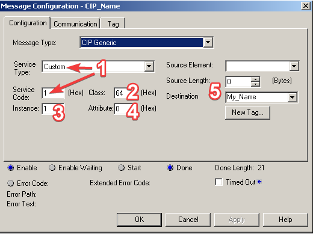
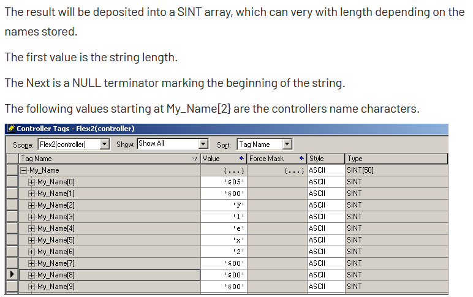

# Generic CIP messages

A generic message sends any CIP service to any object, like a CIP Generic `MSG` instruction in Logix. Use it for
what the drivers don't wrap: drive parameters, module status, the identity of a device, an EDS upload. Any driver
can send one; the CIP driver does nothing else.

| Field | Meaning |
|---|---|
| `service` | the service code, e.g. `0x0E` Get_Attribute_Single, `0x10` Set_Attribute_Single, `0x01` Get_Attributes_All |
| `class_code`, `instance` | the object addressed; instance 0 addresses the class attributes |
| `attribute` | the attribute, if the service takes one |
| `request_data` | the bytes that follow the request path |
| `connected` | send over the CIP connection (default; it is opened first if needed), or unconnected |
| `unconnected_send`, `route_path` | for unconnected messages, wrap them in an Unconnected Send along the driver's path (or another route) to reach a device behind a bridge |
| `name` | a name for the result and the log |

The result is like a tag result: the value is the reply data (raw bytes; Python can decode it with `data_type`)
and a failed reply status is the result's error.

## Read an attribute

This reads the product name of the device (Identity object, class 0x01, instance 1, attribute 7, a SHORT_STRING):

=== "Python"

    ```python
    from ciplink import CIPDriver, Services, SHORT_STRING

    with CIPDriver("192.0.2.10") as drv:
        name = drv.generic_message(
            service=Services.get_attribute_single,
            class_code=0x01,
            instance=1,
            attribute=7,
            data_type=SHORT_STRING,
            connected=False,
            name="product_name",
        )
        print(name.value if name else name.error)     # '1756-EN2T/D'
    ```

=== "Rust"

    ```rust
    use ciplink::cip::{CipDriver, CipOptions, GenericMessage};

    let drv = CipDriver::new("192.0.2.10", CipOptions::default())?;
    drv.open()?;
    let reply = drv.generic_message(&GenericMessage {
        service: 0x0E,
        class_code: 0x01u32.into(),
        instance: 1u32.into(),
        attribute: Some(7u32.into()),
        connected: false,
        name: "product_name".into(),
        ..GenericMessage::default()
    })?;
    match reply.data() {
        Some([len, text @ ..]) => println!("{}", String::from_utf8_lossy(&text[..*len as usize])),
        _ => println!("failed: {:?}", reply.tag.error),
    }
    ```

=== "C#"

    ```csharp
    using System.Text;
    using Ciplink;

    using var drv = new CipDriver("192.0.2.10");
    drv.Open();
    Tag reply = drv.GenericMessage(new Message
    {
        Service = 0x0E, ClassCode = 0x01, Instance = 1, Attribute = 7, Connected = false, Name = "product_name",
    });
    if (reply.IsOk && reply.Value is byte[] data)
        Console.WriteLine(Encoding.ASCII.GetString(data, 1, data[0]));
    else
        Console.WriteLine(reply.Error);
    ```

=== "C++"

    ```cpp
    #include <iostream>
    #include "ciplink.hpp"

    ciplink::Cip drv("192.0.2.10");
    drv.open();
    ciplink::Message m;
    m.service = 0x0E;
    m.class_code = 0x01;
    m.instance = 1;
    m.attribute = 7;
    m.connected = false;
    m.name = "product_name";
    ciplink::Tag reply = drv.generic_message(m);
    if (reply) {
        const auto& data = reply.value.get<ciplink::Bytes>().data;
        std::cout << std::string(data.begin() + 1, data.begin() + 1 + data[0]) << "\n";
    } else {
        std::cout << reply.error->message << "\n";
    }
    ```

=== "C"

    ```c
    #include <stdio.h>
    #include "ciplink.h"

    CiplinkDriver *drv = NULL;
    ciplink_cip_new("192.0.2.10", NULL, &drv);
    if (ciplink_open(drv) == CIPLINK_STATUS_OK) {
        CiplinkMessage m = {0};
        m.service = 0x0E;
        m.class_code = 0x01;
        m.instance = 1;
        m.attribute = 7;          /* negative for none */
        m.connected = false;
        m.name = "product_name";
        char *json = NULL;
        if (ciplink_generic_message(drv, &m, &json) == CIPLINK_STATUS_OK) {
            printf("%s\n", json);  /* {"tag":"product_name","value":{"$bytes":"0b313735362d454e32542f44"},...} */
            ciplink_string_free(json);
        }
    }
    ciplink_driver_free(drv);
    ```

## Reach a device behind a bridge

To message a device through a controller's backplane and Ethernet module, give the driver the route to it and send
the message unconnected with an Unconnected Send along that route. This reads parameter 41 (Accel Time) of a
PowerFlex 525:

```python
from ciplink import CIPDriver, Services, INT

with CIPDriver("192.0.2.10/bp/1/enet/192.0.2.55") as drive:
    param = drive.generic_message(
        service=Services.get_attribute_single,
        class_code=0x93,          # DPI Parameter object
        instance=41,              # parameter 41
        attribute=0x09,           # the parameter's value
        data_type=INT,
        connected=False,
        unconnected_send=True,
        route_path=True,          # along the driver's path
        name="pf525_param",
    )
```

The other bindings set the same fields (`unconnected_send`, and `route_path` left at its default, the driver's
path). [`examples/generic_messaging.py`](https://github.com/RowanRama/ciplink/blob/main/examples/generic_messaging.py)
has more: writing a drive parameter, an Ethernet module's OK LED and link status, a Stratix switch's power status,
IP configuration and MAC address.

## Decoding replies in Python

`data_type` decodes the reply with ciplink's CIP types: elementary types (`INT`, `DINT`, `REAL`, `SHORT_STRING`,
`STRING` ...), arrays of them (`INT[4]`, `INT[None]` for "all that's left") and structures:

```python
from ciplink import Struct, DINT, STRING, REAL

Reading = Struct(DINT("code"), STRING("name"), REAL("value"))
Reading.decode(data)          # {'code': 80, 'name': 'my name', 'value': 123.45}
Reading.encode({"code": 80, "name": "my name", "value": 123.45})
```

Every type has `encode` (a Python value to bytes) and `decode` (bytes to a Python value). Leave `data_type` out
for raw bytes, and for services that return no data (Set_Attribute_Single).

## Raw messages

For full control, `send_connected` and `send_unconnected` (Rust: `send_connected_raw`, `send_unconnected_raw`;
C#: `SendConnected`, `SendUnconnected`; C: `ciplink_send_connected`, `ciplink_send_unconnected`) send bytes you
encoded yourself (service, request path and data) and return the raw reply frame, encapsulation header included.
`send_connected` uses the open CIP connection and doesn't make the Forward Open itself.

## How ciplink got the program name

The Logix driver's `get_plc_name` is itself a generic message. Rockwell's knowledge base article *Obtaining the
Controller's Program Name* shows the `MSG` configuration:



The service is `0x01` (Get_Attributes_All), the class `0x64`, instance 1 and no attribute. The reply is stored in a
`SINT[50]` whose first two bytes are the length and the rest one byte per character:



That is the CIP `STRING` type, so the call is:

```python
plc.generic_message(service=Services.get_attributes_all, class_code=0x64, instance=1,
                    data_type=STRING, name="get_plc_name")
```

Naming the message (`name=`) makes it easy to find in a verbose log.
