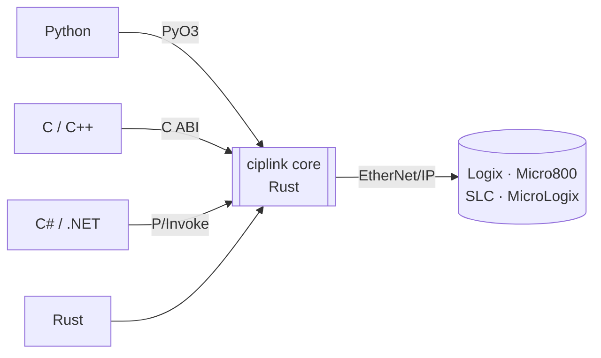

# ciplink

**Read and write Allen-Bradley PLC tags over EtherNet/IP from Python, C, C++, C# or Rust.**

ciplink is a fork of [pycomm3](https://github.com/ottowayi/pycomm3) rebuilt on a shared Rust core. Every language
calls the same driver, so tag reads, packet packing and error handling behave the same everywhere. In Python it
keeps the familiar pycomm3 API and uses several times less CPU per call.



## Install

=== "Python"

    ```sh
    pip install ciplink
    ```

    Python 3.9 or later. The wheels contain the compiled core, so no Rust toolchain is needed.

=== "Rust"

    ```sh
    cargo add ciplink
    ```

=== "C#"

    ```sh
    dotnet add package Ciplink
    ```

    .NET 8 or later. The package contains the native library for Windows x64, Linux x64 and macOS.

=== "C++"

    Download `ciplink-ffi-<version>-<platform>` from the
    [releases page](https://github.com/RowanRama/ciplink/releases): it holds `ciplink.h` and the libraries.
    Add the header-only [`ciplink.hpp`](https://github.com/RowanRama/ciplink/blob/main/bindings/cpp/include/ciplink.hpp)
    (C++17) next to it.

=== "C"

    Download `ciplink-ffi-<version>-<platform>` from the
    [releases page](https://github.com/RowanRama/ciplink/releases): `include/ciplink.h`, plus a shared and a
    static library in `lib/`.

## Quick start

The path is the controller's IP address, `IP/slot` for a ControlLogix outside slot 0, or a full route such as
`192.0.2.10/bp/2/enet/192.0.2.20/bp/0`. Every read and write returns one result per tag. A failure is reported on
that tag's result rather than thrown, so one bad tag never fails a whole batch.

=== "Python"

    ```python
    from ciplink import LogixDriver

    with LogixDriver("192.0.2.10") as plc:
        print(plc.read("Counter"))           # Tag(tag='Counter', value=42, type='DINT', error=None)
        level, recipe = plc.read("Tank.Level", "Recipe{10}")
        plc.write(("Counter", 0), ("Tank.Setpoint", 75.5))
    ```

=== "Rust"

    ```rust
    use ciplink::logix::driver::{LogixDriver, LogixOptions};
    use ciplink::Value;

    let plc = LogixDriver::new("192.0.2.10", LogixOptions::default())?;
    plc.open()?;
    for tag in plc.read(&["Counter", "Tank.Level"])? {
        println!("{} = {:?} {:?}", tag.tag, tag.value, tag.error);
    }
    plc.write(&[("Counter", Value::DInt(0)), ("Tank.Setpoint", Value::Real(75.5))])?;
    plc.close()?;
    ```

=== "C#"

    ```csharp
    using Ciplink;

    using var plc = new LogixDriver("192.0.2.10");
    plc.Open();
    Tag counter = plc.Read("Counter");
    Console.WriteLine(counter.IsOk ? $"{counter.Name} = {counter.Value}" : counter.Error);
    plc.Write(("Counter", 0), ("Tank.Setpoint", 75.5));
    ```

=== "C++"

    ```cpp
    #include <iostream>
    #include "ciplink.hpp"

    ciplink::Logix plc("192.0.2.10");
    plc.open();
    for (const ciplink::Tag& t : plc.read({"Counter", "Tank.Level"}))
        std::cout << t.tag << " = " << ciplink::to_json(t.value) << "\n";
    plc.write({{"Counter", 0}, {"Tank.Setpoint", 75.5}});
    ```

=== "C"

    ```c
    #include <stdio.h>
    #include "ciplink.h"

    CiplinkDriver *plc = NULL;
    if (ciplink_logix_new("192.0.2.10", NULL, &plc) != CIPLINK_STATUS_OK || ciplink_open(plc) != CIPLINK_STATUS_OK) {
        char *err = ciplink_last_error(NULL);
        fprintf(stderr, "%s\n", err);
        ciplink_string_free(err);
        ciplink_driver_free(plc);
        return 1;
    }
    const char *tags[] = {"Counter", "Tank.Level"};
    char *json = NULL;
    if (ciplink_read(plc, tags, 2, &json) == CIPLINK_STATUS_OK) {
        printf("%s\n", json);   /* [{"tag":"Counter","value":42,"type":"DINT","error":null}, ...] */
        ciplink_string_free(json);
    }
    if (ciplink_write(plc, "[[\"Counter\", 0], [\"Tank.Setpoint\", 75.5]]", &json) == CIPLINK_STATUS_OK)
        ciplink_string_free(json);
    ciplink_driver_free(plc);   /* closes the connection */
    ```

## What it does

| | |
|---|---|
| **Controllers** | ControlLogix, CompactLogix, GuardLogix and Micro800 with the Logix driver; SLC 500 and MicroLogix with the SLC driver; generic CIP messaging to any EtherNet/IP device with the CIP driver |
| **Tag types** | atomic types, arrays, strings, UDTs (whole or by member), AOIs, bits of integers, bit strings (BYTE, WORD, DWORD, LWORD) and BOOL arrays |
| **Throughput** | many tags packed into each packet, with large values fragmented and chunked automatically |
| **Tag discovery** | the tag list and UDT definitions are uploaded on connect, or loaded on first use with `lazy_tags`; a tag cache file makes restarts near-instant |
| **Online-edit safe** | tags are addressed by instance ID and checked against the controller's tag-table version, so an online edit never silently returns the wrong tag |
| **Extras** | [tag descriptions](descriptions.md), PLC clock, [device discovery and RSWho-style browsing](browsing.md), [controller-side trends](trends.md), a [tag server](server.md) for web apps, an opt-in [adapter](adapter.md) role, and a [simulated controller](simulator.md) for tests |

The C, C++ and C# examples in this wiki are fragments: put them inside `main` (C, C++) or a top-level program
(C#). Rust examples run inside a function that returns `ciplink::Result<()>` or
`Result<(), Box<dyn std::error::Error>>`.

## Where to get help

- Questions and bug reports: [GitHub issues](https://github.com/RowanRama/ciplink/issues)
- Source: [github.com/RowanRama/ciplink](https://github.com/RowanRama/ciplink)
- Packages: [PyPI](https://pypi.org/project/ciplink/), [crates.io](https://crates.io/crates/ciplink),
  [NuGet](https://www.nuget.org/packages/Ciplink), [GitHub releases](https://github.com/RowanRama/ciplink/releases)
